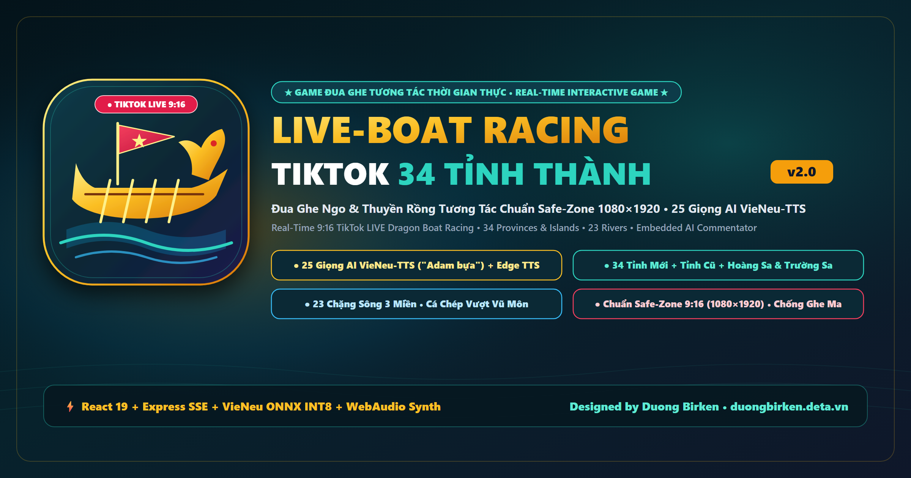
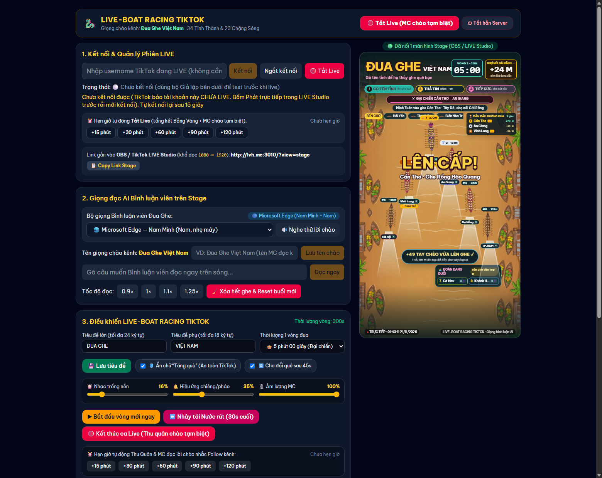
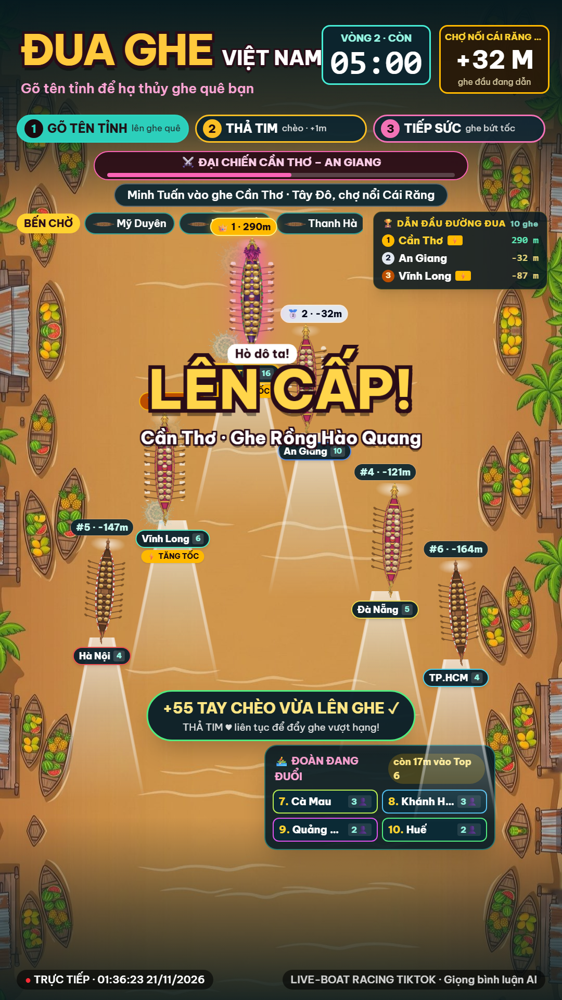
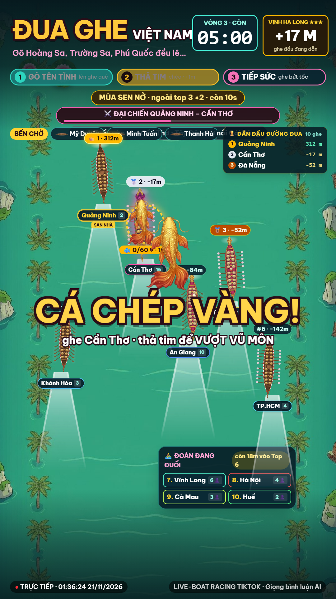
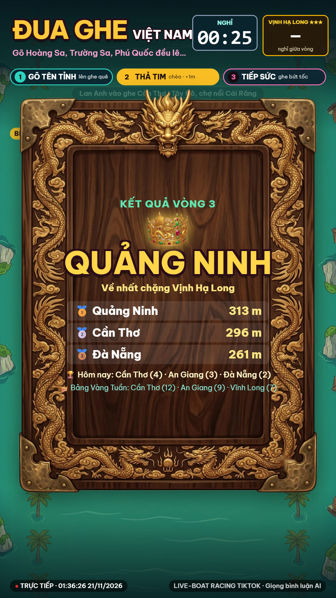
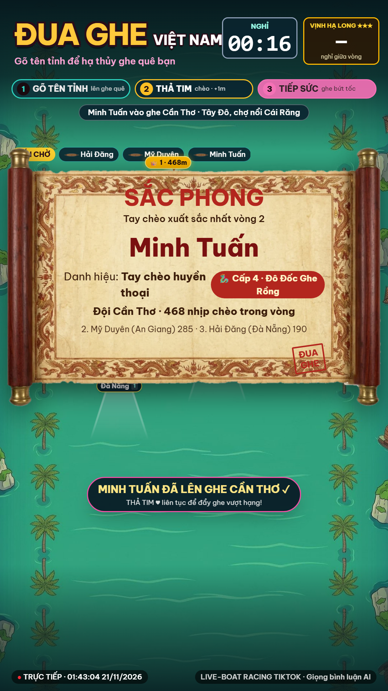
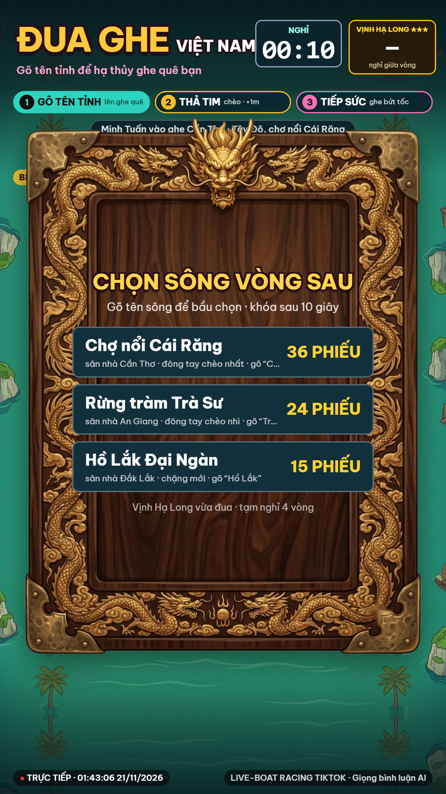
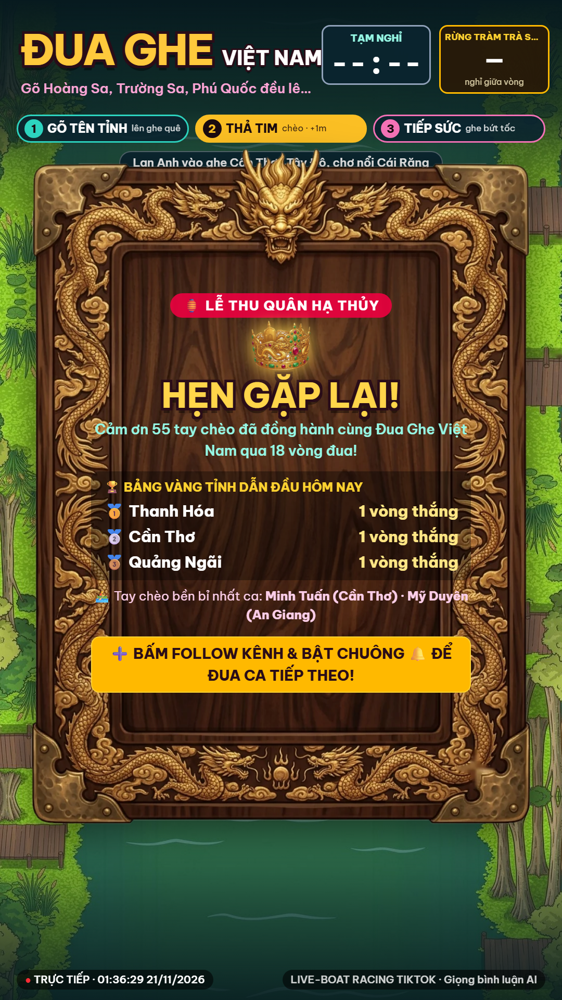

# 📖 CẨM NANG HƯỚNG DẪN SỬ DỤNG LIVE-BOAT RACING TIKTOK TOÀN TẬP (A–Z)
## LIVE-BOAT RACING TIKTOK v2.0 — Comprehensive Bilingual User Guide (Tiếng Việt 🇻🇳 & English 🇬🇧)

<div align="center">
  
</div>

> **Trang chủ Tác giả / Official Author Website:** [https://duongbirken.deta.vn](https://duongbirken.deta.vn)  
> **Kho mã nguồn & Tải về / GitHub Repository:** [https://github.com/duongbirken2510/LIVE-BoatRacing-Tiktok](https://github.com/duongbirken2510/LIVE-BoatRacing-Tiktok)  
> **Bản Hướng Dẫn trong `docs/`:** [`docs/USER_GUIDE.md`](./docs/USER_GUIDE.md) • **Hồ sơ Kiến trúc 10 Chương:** [`info/Introduce_LiveBoatRacingTiktok.md`](./info/Introduce_LiveBoatRacingTiktok.md)

---

## 📑 Mục Lục Nhanh / Quick Navigation
- **Phần A — 🇻🇳 Hướng Dẫn Sử Dụng Tiếng Việt (Từ A đến Z)**
  1. [Bước 1: Cài đặt & Khởi động nhanh bằng 1 cú nhấp đúp (`BAT-LIVE.bat`)](#1-bước-1-cài-đặt--khởi-động-nhanh-bằng-1-cú-nhấp-đúp-bat-livebat)
  2. [Bước 2: Đưa sân khấu dọc 9:16 (`1080 × 1920`) vào TikTok LIVE Studio & OBS Studio](#2-bước-2-đưa-sân-khấu-dọc-916-1080--1920-vào-tiktok-live-studio--obs-studio)
  3. [Bước 3: Kết nối phòng TikTok LIVE & Đổi 25 Giọng AI Bình luận viên ("Adam bựa")](#3-bước-3-kết-nối-phòng-tiktok-live--đổi-25-giọng-ai-bình-luận-viên-adam-bựa)
  4. [Bước 4: Làm chủ Luật chơi, Điều khiển Vòng đua, Sự kiện & Hẹn giờ Tự Tắt Live](#4-bước-4-làm-chủ-luật-chơi-điều-khiển-vòng-đua-sự-kiện--hẹn-giờ-tự-tắt-live)
  5. [Bước 5: Quản lý Dữ liệu Bảng Vàng, Cấp bậc Thủy Thủ & Bảo vệ An toàn Kênh TikTok](#5-bước-5-quản-lý-dữ-liệu-bảng-vàng-cấp-bậc-thủy-thủ--bảo-vệ-an-toàn-kênh-tiktok)
  6. [Bước 6: Mẹo tối ưu RAM/GPU & Xử lý sự cố thường gặp (Troubleshooting FAQ)](#6-bước-6-mẹo-tối-ưu-ramgpu--xử-lý-sự-cố-thường-gặp-troubleshooting-faq)
- **Part B — 🇬🇧 English User Guide (Step-by-Step)**
  1. [Step 1: Installation & 1-Click Launch on Windows, macOS, and Linux](#step-1-installation--1-click-launch-on-windows-macos-and-linux)
  2. [Step 2: Embedding the 9:16 Stage (`1080 × 1920`) in TikTok LIVE Studio & OBS](#step-2-embedding-the-916-stage-1080--1920-in-tiktok-live-studio--obs)
  3. [Step 3: Connecting TikTok LIVE, Configuring 25 AI Voices & Running Auto-Live](#step-3-connecting-tiktok-live-configuring-25-ai-voices--running-auto-live)
  4. [Step 4: Game Rules, Data Persistence, Safety Toggles & Troubleshooting](#step-4-game-rules-data-persistence-safety-toggles--troubleshooting)

---

# 🇻🇳 PHẦN A — HƯỚNG DẪN SỬ DỤNG TIẾNG VIỆT (TỪ A ĐẾN Z)

## 1. Bước 1: Cài đặt & Khởi động nhanh bằng 1 cú nhấp đúp (`BAT-LIVE.bat`)

### 💻 A. Trên máy tính Windows 10 / 11 (64-bit) — Khuyên dùng
1. **Cài đặt Node.js (chỉ cần làm 1 lần duy nhất):**
   - Tải và cài đặt bản **Node.js 20 LTS trở lên** tại [https://nodejs.org](https://nodejs.org).
2. **Khởi động Game ngay lập tức:**
   - Mở thư mục dự án, nhấp đúp chuột vào file **`BAT-LIVE.bat`**.
   - *(Nếu Windows hiện bảng xanh **Windows protected your PC / SmartScreen**, bạn bấm vào chữ **More info (Thông tin thêm)** ➔ bấm **Run anyway (Vẫn chạy)**).*
   - Lần đầu tiên chạy, cửa sổ sẽ tự động tải thư viện `node_modules` trong khoảng 1–2 phút, sau đó tự động mở trang **Bảng Điều Khiển (Dashboard)** trên trình duyệt tại địa chỉ:
     ```text
     http://localhost:3010
     ```
3. **Cài đặt thêm 25 Giọng AI Offline VieNeu-TTS ("Adam bựa", "Trúc Ly"...) — Tùy chọn:**
   - Ngay khi mới mở `BAT-LIVE.bat`, game đã **chạy sẵn mượt mà với 2 giọng Microsoft Edge Neural (`Nam Minh` & `Hoài My`)** mà không cần cài thêm gì.
   - Nếu trên máy bạn đã có sẵn thư mục `VieNeu-TTS` (từ các bộ `LIVE-TRANGNGUYEN` hoặc `LIVE-CLASS`), game sẽ **tự động phát hiện và dùng chung ngay**!
   - Nếu máy mới hoàn toàn và bạn muốn cài thêm **25 giọng AI VieNeu-TTS v3 Turbo Offline**:
     1. Cài **Python 3.11 hoặc 3.12** từ [https://www.python.org/downloads/](https://www.python.org/downloads/) *(nhớ tích ô **"Add python.exe to PATH"** lúc cài)*.
     2. Nhấp đúp vào file **`CAI-GIONG-ADAM.bat`** và đợi khoảng 3–5 phút để tải model `onnx_int8` (~250 MB). Từ lần sau, chỉ cần bấm `BAT-LIVE.bat` là có đủ 25 giọng!

### 🍎 B. Trên máy MacBook / iMac (macOS) & 🐧 Linux
Mở **Terminal** tại thư mục dự án và chạy 2 lệnh:
```bash
npm install
npm run dev
```
Sau đó mở trình duyệt truy cập **`http://localhost:3010`**.

---

## 2. Bước 2: Đưa sân khấu dọc 9:16 (`1080 × 1920`) vào TikTok LIVE Studio & OBS Studio



Trên trang Bảng Điều Khiển **`http://localhost:3010`**, ở cuối khung số 1 có nút **`📋 Copy Link Stage`**. Bấm vào đó để chép đường dẫn sân khấu sạch:
```text
http://lvh.me:3010/?view=stage
```

### 📱 Cách 1: Gắn vào TikTok LIVE Studio (Trực tiếp trên PC)
1. Mở phần mềm **TikTok LIVE Studio** và chuyển khung cảnh sang chế độ **Màn hình dọc (Portrait 9:16)**.
2. Bấm nút **Thêm nguồn (Add Source)** ➔ chọn **Liên kết (Link / Browser)**.
3. Cấu hình thông số nguồn Liên kết:
   - **URL:** Dán **`http://lvh.me:3010/?view=stage`**
   - **Độ phân giải (Resolution):** Chỉnh thành **`1080`** × **`1920`**
   - **Âm thanh:** Bật công tắc thu âm thanh từ nguồn Liên kết.
4. Bấm **Thêm (Add)** và kéo khung vừa khít toàn màn hình dọc.

### 🎥 Cách 2: Gắn vào OBS Studio (Phát qua Virtual Camera hoặc Stream Key RTMP)
1. Mở **OBS Studio** ➔ vào **Settings (Cài đặt) ➔ Video**:
   - **Base (Canvas) Resolution:** gõ `1080x1920`
   - **Output (Scaled) Resolution:** gõ `1080x1920`
   - **Common FPS Values:** `30` hoặc `60` FPS ➔ bấm **Apply & OK**.
2. Tại bảng **Sources (Nguồn)**, bấm dấu **`+`** ➔ chọn **Browser (Trình duyệt)**:
   - **URL:** `http://lvh.me:3010/?view=stage`
   - **Width:** `1080`
   - **Height:** `1920`
   - ✅ Tích chọn **"Control audio via OBS"** (*Điều khiển âm thanh qua OBS*).
3. Trong khung **Audio Mixer** của OBS, nếu bạn muốn vừa nghe tiếng Bình luận viên và tiếng trống hội qua loa/tai nghe vừa phát lên sóng, bấm biểu tượng bánh răng cạnh thanh âm thanh **Browser** ➔ chọn **Advanced Audio Properties** ➔ đổi cột **Audio Monitoring** thành **`Monitor and Output`**.

---

## 3. Bước 3: Kết nối phòng TikTok LIVE & Đổi 25 Giọng AI Bình luận viên ("Adam bựa")

| 🚣 Sân Khấu Đua Ghe 6 Làn Phân Tầng Chuẩn Safe-Zone 9:16 | 🐟 Sự Kiện Cá Chép Vàng Vượt Vũ Môn & Mùa Sen Nở (`×2`) |
| :---: | :---: |
|  |  |

1. **Kết nối phòng TikTok LIVE (Mục 1):** Bấm **Go LIVE** trên TikTok trước, sau đó nhập `username` TikTok vào Mục 1 trên Dashboard và bấm **`Kết nối`**.
2. **Đổi 25 Giọng Đọc AI (Mục 2):** Chọn giọng **`🎙️ VieNeu AI: Adam bựa`**, **`Trúc Ly`** hoặc **`🌐 Microsoft Edge — Nam Minh / Hoài My`** trong danh sách thả xuống. Bấm **`🔊 Nghe thử lời chào`** để nghe thử ngay.
3. **Đặt Tên Giọng Chào Kênh & Đọc Ngay:** Lưu tên kênh của bạn để MC đọc khi chào khách mới / cảm ơn Follow, hoặc gõ câu bất kỳ vào ô **`Đọc ngay`** để MC phát biểu trực tiếp trên sóng.

---

## 4. Bước 4: Làm chủ Luật chơi, Điều khiển Vòng đua, Sự kiện & Hẹn giờ Tự Tắt Live

| 🏆 Bảng Kết Quả Vòng & Bảng Vàng Tỉnh Hôm Nay / Tuần Này | 📜 Chiếu Sắc Phong Tay Chèo MVP & Cấp Bậc Thủy Thủ Trọn Đời |
| :---: | :---: |
|  |  |

| 🗳️ Bầu Chọn Khúc Sông Vòng Sau Bằng Bình Luận | 🏮 Màn Hình Lễ Thu Quân Hạ Thủy & Kêu Gọi Follow Cuối Ca |
| :---: | :---: |
|  |  |

- **3 Bước chơi cho khán giả:**
  1. **Gõ tên tỉnh / tỉnh cũ / tên đảo (Hoàng Sa, Trường Sa, Phú Quốc, Côn Đảo, Lý Sơn, Cát Bà)** để lên đúng ghe quê hương.
  2. **Thả tim ♥ (`+1m/tim`)** hoặc **gõ bình luận cổ vũ trên ghe (`+3m` mỗi 8 giây)** để đẩy ghe vượt hạng.
  3. **Tặng quà / Tiếp sức (`+8m/s` trong `2–60 giây`)** để bật tên lửa bứt tốc.
- **Bảo lưu Quà & Tim chưa lên ghe:** Khách mới lỡ thả tim / tặng quà trước khi gõ tên tỉnh vẫn được giữ nguyên trong 10 phút và cộng bù ngay khi gõ tên tỉnh!
- **Hẹn giờ Tự Động Tắt Live (`+15p..+120p`) & Nút `🛑 Tắt Live`:** Tự động mở **🏮 Lễ Thu Quân Hạ Thủy**, tổng kết Bảng Vàng, MC cảm ơn 34 tỉnh và nhắc khán giả bấm **Follow + Chuông thông báo 🔔**.

---

## 5. Bước 5: Quản lý Dữ liệu Bảng Vàng, Cấp bậc Thủy Thủ & Bảo vệ An toàn Kênh TikTok

- **Công tắc `🛡️ Ẩn chữ "Tặng quà" (An toàn TikTok)`:** Đổi nhãn bước 3 trên màn hình Stage thành **`TIẾP SỨC · ghe bứt tốc`** để tránh vi phạm chính sách kêu gọi quà tặng.
- **Bộ lọc `isRudeName` nhiều lớp:** Tự động chặn mọi tên nhạy cảm, viết lách (`l0n`, `đ.ị.t`, `djt123`...) và không bao giờ đọc nguyên văn nội dung bình luận tự do của người xem.
- **Lưu trữ tự động:** `settings.json` (cấu hình kênh), `data/bang-vang.json` (Bảng Vàng Ngày & Tuần), `data/tay-cheo.json` (5 Cấp Bậc Thủy Thủ Trọn Đời).

---

## 6. Bước 6: Mẹo tối ưu RAM/GPU & Xử lý sự cố thường gặp (Troubleshooting FAQ)

- **Bật tiếng sân khấu:** Trong OBS / TikTok LIVE Studio, nhớ bật thu âm thanh của nguồn Browser/Link; nếu trình duyệt chặn tự phát âm thanh, bấm chuột 1 lần vào nút vàng **"🔊 Bấm vào đây để bật tiếng"**.
- **Giảm tải GPU:** Khung xem trước bên phải Dashboard đã tự động chạy ở chế độ `lite=true` (tắt các lớp bóng đổ nặng). Không mở thêm nhiều tab `/?view=stage` thừa trên trình duyệt.

---
---

# 🇬🇧 PART B — ENGLISH USER GUIDE (STEP-BY-STEP)

## Step 1: Installation & 1-Click Launch on Windows, macOS, and Linux
- Install **Node.js 20 LTS+**, then double-click **`BAT-LIVE.bat`** on Windows (or run `npm install && npm run dev` on macOS/Linux).
- The Control Dashboard opens automatically at **`http://localhost:3010`**.
- Optional: Double-click **`CAI-GIONG-ADAM.bat`** (requires Python 3.11/3.12) to install all **25 offline VieNeu-TTS v3 Turbo Vietnamese AI voices** (*"Adam bựa"*, *"Trúc Ly"*...).

## Step 2: Embedding the 9:16 Stage (`1080 × 1920`) in TikTok LIVE Studio & OBS
- Copy **`http://lvh.me:3010/?view=stage`** using the **`📋 Copy Link Stage`** button on the Dashboard.
- Add it as a **Link / Browser Source** at **`1080 × 1920`** vertical resolution with audio capture enabled.

## Step 3: Connecting TikTok LIVE, Configuring 25 AI Voices & Running Auto-Live
- Go LIVE on TikTok first, then enter your `@username` in Card 1 and click **`Kết nối`**.
- Switch between **25 VieNeu-TTS AI voices** and **Microsoft Edge Neural voices** in Card 2, or click **`🤖 Bật Auto-Live`** in Card 3 to run an automated crowd simulation.

## Step 4: Game Rules, Data Persistence, Safety Toggles & Troubleshooting
- Viewers type any of the **34 post-2025 provinces, historical pre-merger provinces, or Vietnamese islands (Hoàng Sa, Trường Sa, Phú Quốc, Côn Đảo)** to board their hometown boat, tap hearts (`+1m/like`) or comment cheers (`+3m/8s`) to row, and send gifts (`+8m/s` for `2–60s`) to boost.
- Enable **`🛡️ Ẩn chữ "Tặng quà" (An toàn TikTok)`** for strict TikTok policy compliance, and use the **`+15p..+120p` Auto-Stop Timer** to trigger the **🏮 End-of-Stream Farewell Ceremony** automatically.
