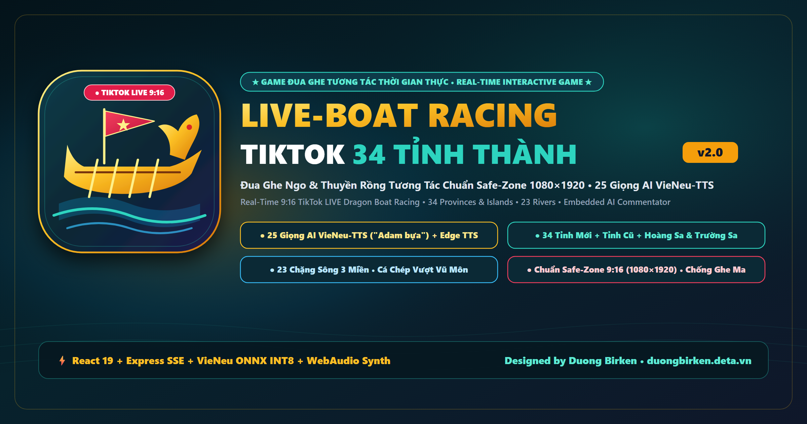
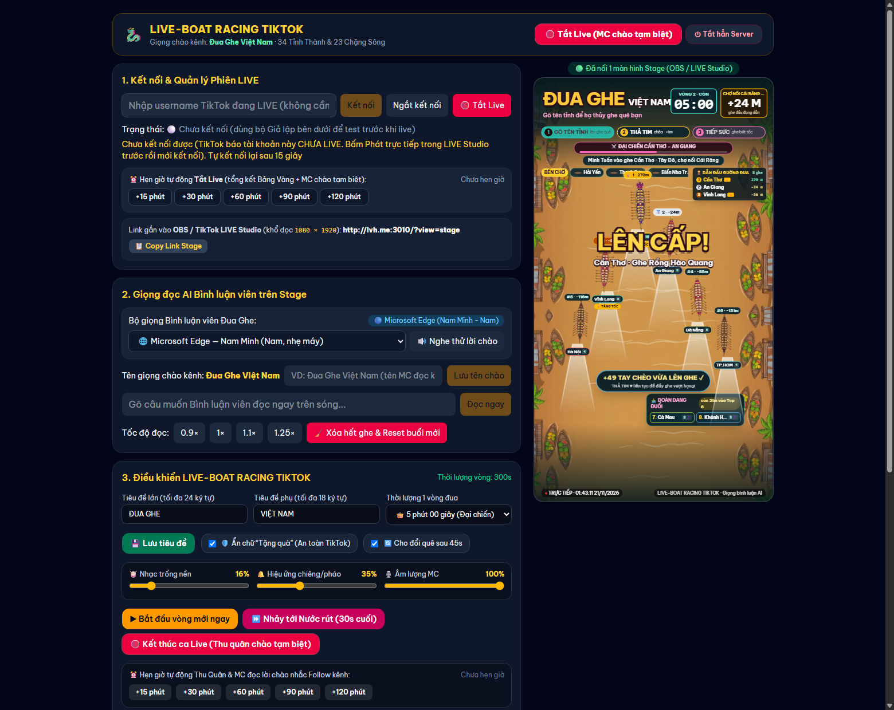
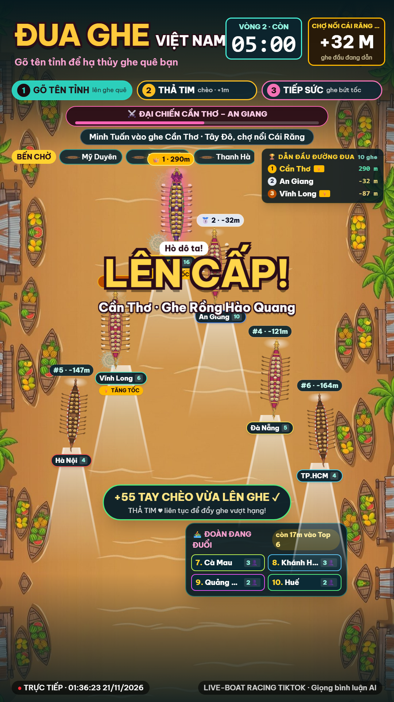
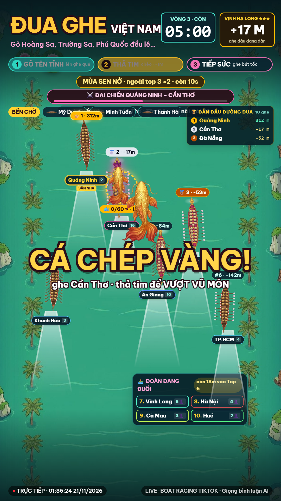
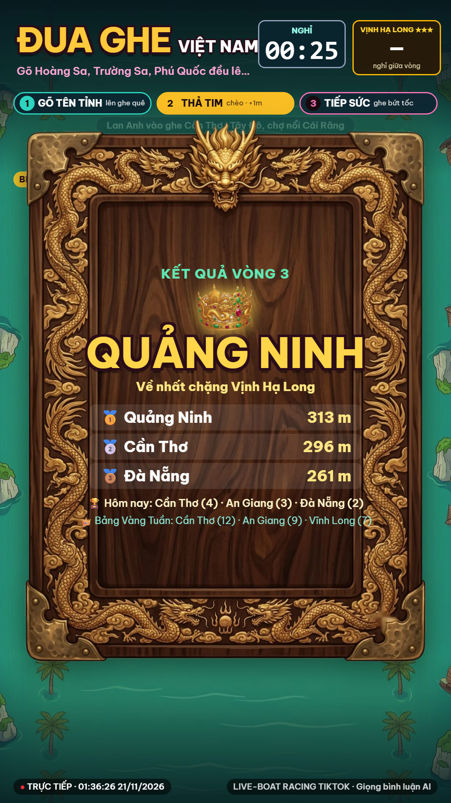
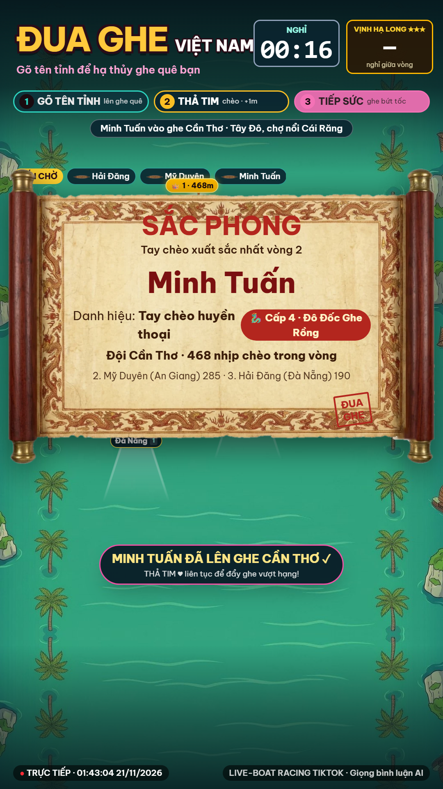
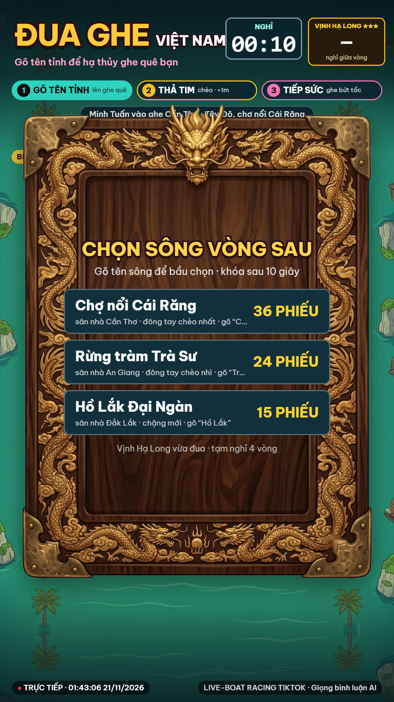
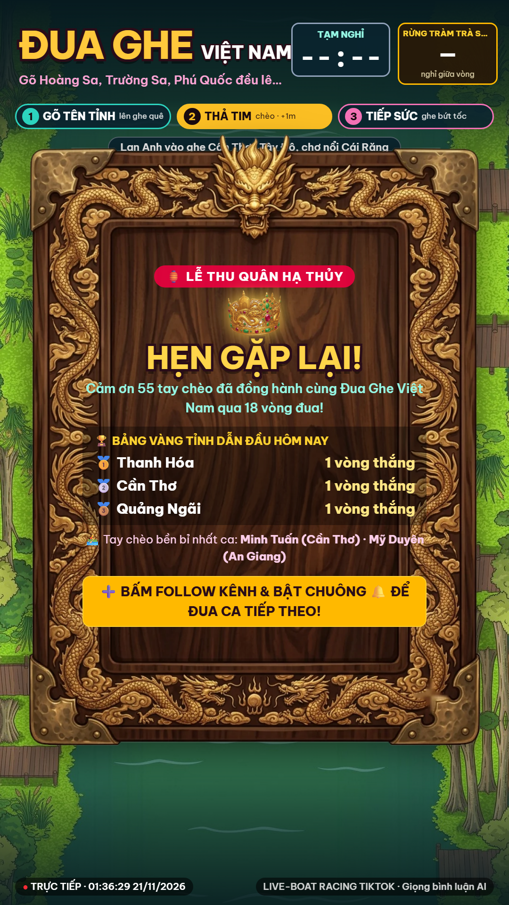
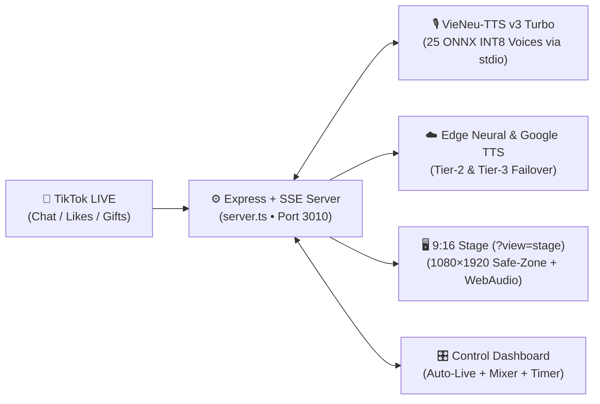
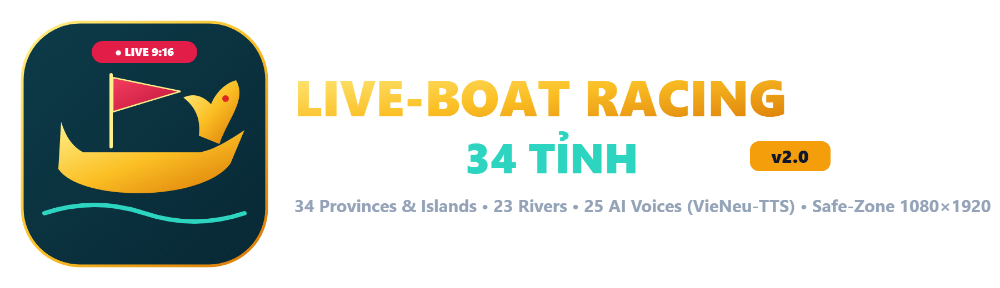

<div align="center">



# 🐉 LIVE-BOAT RACING TIKTOK (`v2.0`)
### Game Đua Ghe Ngo & Thuyền Rồng 34 Tỉnh Thành Tương Tác Thời Gian Thực Chuẩn Safe-Zone Cho TikTok LIVE (`1080 × 1920`)
**Real-Time 9:16 Interactive Dragon Boat Racing Game Show for TikTok LIVE Studio & OBS Studio**

[](https://github.com/duongbirken2510/LIVE-BoatRacing-Tiktok)
[-14b8a6?style=for-the-badge)](http://lvh.me:3010/?view=stage)
[](https://github.com/duongbirken2510/LIVE-BoatRacing-Tiktok)
[](https://duongbirken.deta.vn)

[**🇻🇳 Mô Tả Dự Án & Hướng Dẫn Tiếng Việt**](#-tổng-quan-dự-án-tiếng-việt) &nbsp;•&nbsp; [**🇬🇧 English Project Description & Guide**](#-english-project-overview--documentation) &nbsp;•&nbsp; [**📖 Cẩm Nang Hướng Dẫn Sử Dụng A–Z (`USER_GUIDE.md`)**](./docs/USER_GUIDE.md) &nbsp;•&nbsp; [**🏛️ Hồ Sơ Kiến Trúc Kỹ Thuật 10 Chương**](./info/Introduce_LiveBoatRacingTiktok.md)

</div>

---

# 🇻🇳 TỔNG QUAN DỰ ÁN (TIẾNG VIỆT)

**LIVE-BOAT RACING TIKTOK (`v2.0`)** là hệ thống **Game Show Đua Ghe Ngo & Đua Thuyền Rồng Tương Tác Thời Gian Thực** được thiết kế chuẩn khung dọc **9:16 (`1080 × 1920`)** dành riêng cho **TikTok LIVE Studio** và **OBS Studio**, phát triển và nâng cấp toàn diện bởi [**Duong Birken**](https://duongbirken.deta.vn).

Khán giả xem phiên LIVE trực tiếp tham gia vào đường đua sông nước sôi động chỉ với 3 thao tác tự nhiên:
1. **🚣 Bước 1 — GÕ TÊN TỈNH (Hạ thủy lên ghe quê hương):** Bình luận tên một trong **34 tỉnh thành mới (sau sắp xếp 2025)**, tên **tỉnh cũ trước sáp nhập** (*Bến Tre, Sóc Trăng, Bình Dương, Quảng Nam, Hải Dương, Kiên Giang...*), hoặc tên **đảo / quần đảo thiêng liêng của Tổ quốc** (*Hoàng Sa, Trường Sa, Phú Quốc, Côn Đảo, Lý Sơn, Cát Bà...*) để lập tức gia nhập đúng chiến thuyền quê nhà.
2. **❤️ Bước 2 — THẢ TIM & HÒ REO (Đẩy ghe rẽ sóng):** Mỗi lượt chạm thả tim trên màn hình đẩy ghe quê hương tiến lên **`+1 mét`** (nhân hệ số sân nhà `+10%`, cấp thuyền rồng `+5%..+15%` và sự kiện giữa sông). Khi đã ngồi trên ghe, người xem gõ bình luận cổ vũ còn được thưởng thêm **`+3 mét`** (mỗi 8 giây) kèm tiếng hò dô trên mặt nước.
3. **⚡ Bước 3 — TIẾP SỨC / TẶNG QUÀ (Bật tên lửa bứt tốc):** Quà tặng kích hoạt chế độ **Tăng Tốc (`+8 m/s` kéo dài từ `2 đến 60 giây`)** kèm hiệu ứng tia nước trắng xóa và giọng đọc **Bình luận viên AI (25 giọng VieNeu-TTS v3 Turbo như *"Adam bựa"*, *"Trúc Ly"* hoặc Microsoft Edge Neural TTS)** gọi tên cảm ơn trực tiếp trên sóng!

> 📚 **Tài Liệu Chi Tiết Đính Kèm Trong Kho Mã Nguồn:**
> - 📖 **Hướng Dẫn Sử Dụng Toàn Tập (A–Z) Song Ngữ Việt – Anh:** Xem tại [**`docs/USER_GUIDE.md`**](./docs/USER_GUIDE.md) hoặc [**`HUONG-DAN-SU-DUNG.md`**](./HUONG-DAN-SU-DUNG.md).
> - 🏛️ **Hồ Sơ Giới Thiệu Sản Phẩm & Kiến Trúc Kỹ Thuật 10 Chương:** Xem tại [**`info/Introduce_LiveBoatRacingTiktok.md`**](./info/Introduce_LiveBoatRacingTiktok.md).

---

## 📥 Tải Bộ Cài Đặt Windows 1-Click (`.EXE`) — Không Cần Cài Node.js!

Người dùng Windows 10/11 có thể tải trực tiếp **1 file cài đặt `.exe` duy nhất** (đã tích hợp sẵn Node.js Runtime, giao diện cài đặt Tiếng Việt, tự động tạo biểu tượng ngoài màn hình Desktop và chạy ngầm không hiện cửa sổ CMD đen):

| Phiên bản tải về | File cài đặt / Thực thi | Đặc điểm nổi bật | Link Tải Trực Tiếp (GitHub Releases & Repo) |
| :--- | :--- | :--- | :--- |
| **💿 Bộ Cài Đặt Tự Động 1-Click *(Khuyên dùng cho Người dùng cuối)*** | **`LIVE-BoatRacing-Tiktok-v2.0.0-Setup.exe`** | Giao diện cài đặt Tiếng Việt • Tích hợp sẵn `node.exe` • Tự tạo icon Desktop & mở ngay Bảng điều khiển | [**⬇️ Tải `LIVE-BoatRacing-Tiktok-v2.0.0-Setup.exe` (GitHub Release)**](https://github.com/duongbirken2510/LIVE-BoatRacing-Tiktok/releases/download/v2.0.0/LIVE-BoatRacing-Tiktok-v2.0.0-Setup.exe) <br> *(Hoặc tải trong thư mục [`Release_Windows/`](./Release_Windows/LIVE-BoatRacing-Tiktok-v2.0.0-Setup.exe))* |
| **🚀 File Chạy Trực Tiếp Không Cửa Sổ Đen *(Khi tải mã nguồn)*** | **`LIVE-BoatRacing-Tiktok.exe`** | Nhấp đúp chạy ngầm máy chủ và mở ngay cửa sổ điều khiển App Mode | [**⬇️ Tải `LIVE-BoatRacing-Tiktok.exe`**](./LIVE-BoatRacing-Tiktok.exe) |

---

## 🌟 6 Điểm Đột Phá Của Phiên Bản `v2.0`

| Hạng mục nâng cấp (`v2.0`) | Chi tiết công nghệ & Trải nghiệm thực tế | Giá trị mang lại cho Chủ kênh |
| :--- | :--- | :--- |
| **1. 🎙️ Nhúng Ngầm 25 Giọng AI VieNeu-TTS v3 Turbo (`onnx_int8`) + Dự Phòng 3 Tầng** | • Chạy trực tiếp worker Python `tools/vieneu-worker.py` qua **đường ống nhị phân `stdio` (`>BII` 9-byte framing)** ngay trong 1 cửa sổ duy nhất — không mở cửa sổ CMD thứ 2, không chiếm cổng TCP `8000`.<br>• Tự động dùng chung thư mục `VieNeu-TTS` nếu trên máy đã có (hoặc cài mới bằng 1 cú nhấp đúp `CAI-GIONG-ADAM.bat`).<br>• Chuỗi dự phòng 3 tầng bất tử: **`VieNeu-TTS Offline`** ➔ **`Microsoft Edge Neural (Nam Minh / Hoài My)`** ➔ **`Google Translate TTS`**. | Giọng bình luận viên **"Adam bựa"** hài hước, máu lửa, độ trễ `< 300ms`, chạy liên tục 24/7 không bao giờ mất tiếng hay sập server. |
| **2. 📱 Bố Cục Sân Khấu 9:16 Chuẩn Safe-Zone Điện Thoại TikTok (`1080 × 1920`)** | • Đường đua **6 làn rộng thoáng (`LAN_X`)** phân tầng cao – thấp rõ rệt theo Thứ hạng (`STEP_HANG = 96px`) kết hợp khoảng cách mét thực tế và huy hiệu **`👑 1` · `🥈 2` · `🥉 3`** ngay trên mũi ghe.<br>• Cụm **`🚣 ĐOÀN ĐANG ĐUỔI`** đặt gọn ở cột phải-giữa (`x: 508..952, y: 1430`), **né 100% khung bình luận góc dưới trái** và dải nút Tim/Quà mép phải của ứng dụng TikTok.<br>• Bản xem trước trên Dashboard chạy chế độ **`lite=true`** giảm 50% tải GPU. | Người xem trên mọi dòng điện thoại iOS/Android nhìn thoáng qua biết ngay thứ hạng quê mình, không bị chữ bình luận TikTok đè khuất. |
| **3. 🗺️ 34 Tỉnh Thành Mới + Tỉnh Cũ Trước Sáp Nhập + Biển Đảo Tổ Quốc** | • Nhận diện đầy đủ **34 tỉnh thành sau sắp xếp 2025**, toàn bộ **tỉnh cũ trước sáp nhập** (*Bến Tre ➔ Vĩnh Long, Sóc Trăng/Hậu Giang ➔ Cần Thơ, Bình Dương/Vũng Tàu ➔ TP.HCM, Quảng Nam ➔ Đà Nẵng, Kiên Giang ➔ An Giang...*).<br>• Vinh danh **Biển Đảo Tổ Quốc**: gõ *Hoàng Sa* lên ghe Đà Nẵng, *Trường Sa* lên ghe Khánh Hòa, *Phú Quốc* lên ghe An Giang, *Côn Đảo* lên ghe TP.HCM, *Lý Sơn* lên ghe Quảng Ngãi, *Cát Bà* lên ghe Hải Phòng.<br>• Xét dấu tiếng Việt thông minh trước khi bỏ dấu (`prep()`): gõ *"chào chị Huệ"* hay *"sơn là"* **không bao giờ bị bắt nhầm** thành *Huế* hay *Sơn La*. | Khơi dậy niềm tự hào quê hương và biển đảo, kéo bình luận tự nhiên tăng vọt mà không bỏ sót bất kỳ người xem nào. |
| **4. 🌊 23 Chặng Sông Nước 3 Miền & 4 Sự Kiện Cao Trào Giữa Sông** | • **23 danh thắng sông nước** từ Bắc vào Nam kèm hiệu ứng **Sân Nhà (`+10% tốc độ`)** và bầu chọn sông bằng bình luận cuối mỗi vòng.<br>• 4 Sự kiện ngẫu nhiên & bấm tay: **🐟 Cá Chép Vàng (`Vượt Vũ Môn` nhảy tới `+140m`)**, **🐉 Sức Rồng (`+20%` tốc độ)**, **🪨 Khúc Sông Hẹp (ghìm ghe đầu `-20%`)**, **🪷 Mùa Sen Nở (`×2 mét` cho ghe ngoài Top 3)**, cùng thanh **⚔️ Đại Chiến Song Mã**. | Nhịp trận đấu luôn kịch tính, các ghe phía sau luôn có cơ hội lật kèo ở 30 giây Nước Rút (`150 BPM`). |
| **5. ⚖️ Bảo Lưu Quà/Tim Chưa Lên Ghe, Đổi Quê 45s & Lọc "Ghe Ma"** | • **Kho bảo lưu `this.treo` (10 phút):** Khách mới lỡ tặng quà hoặc thả tim (tối đa `150 tim`) trước khi gõ tên tỉnh sẽ được **giữ nguyên 100%** — vừa gõ tên tỉnh là kích hoạt cộng bù và đẩy tên lửa ngay!<br>• **Cho phép đổi quê sau 45 giây** (có công tắc bật/tắt trên Dashboard).<br>• **Quân Số Thực Chiến (Chống Ghe Ma):** Tay chèo im lặng quá `6 phút` tự động tạm nghỉ đầu vòng mới để tránh ghe giữ cấp *Rồng Vàng* ảo. | Không một giọt mồ hôi hay món quà nào của khán giả bị lãng phí; thế trận giữa các tỉnh luôn cân bằng, sòng phẳng suốt ca live dài. |
| **6. 🏆 Bảng Vàng Ngày/Tuần, Sắc Phong Thủy Thủ Trọn Đời & Lễ Thu Quân** | • Lưu bền vững **Bảng Vàng Hôm Nay & Bảng Vàng Tuần (`data/bang-vang.json`)** cùng **Chiếu Sắc Phong MVP & 5 Cấp Bậc Thủy Thủ Trọn Đời (`data/tay-cheo.json`)**.<br>• Tích hợp **Hẹn giờ tự động Tắt Live (`+15p..+120p`)** chuyển sang màn hình **🏮 Lễ Thu Quân Hạ Thủy**, MC đọc lời cảm ơn 34 tỉnh và kêu gọi khán giả **Follow + Bật chuông 🔔**. | Tăng tỷ lệ chuyển đổi Follow cuối buổi phát và giữ chân khán giả quen quay lại mỗi ngày để nâng cấp bậc Thủy Thủ. |

---

## 📸 Thư Viện Hình Ảnh Giao Diện Hệ Thống (`v2.0`)

### 1. Bàn Điều Khiển Trung Tâm & Xem Trước Sân Khấu 9:16 Thời Gian Thực (`http://localhost:3010`)


### 2. Sân Khấu Đua Ghe 9:16 (`1080 × 1920`) & Sự Kiện Cá Chép Vượt Vũ Môn (`http://lvh.me:3010/?view=stage`)
| 🚣 Đường Đua 6 Làn Phân Tầng & Đoàn Đang Đuổi Chuẩn Safe-Zone | 🐟 Sự Kiện Cá Chép Vàng Vượt Vũ Môn & Mùa Sen Nở (`×2`) |
| :---: | :---: |
|  |  |

### 3. Bảng Kết Quả Vòng + Bảng Vàng Ngày/Tuần & Chiếu Sắc Phong Tay Chèo Xuất Sắc Nhất
| 🏆 Kết Quả Vòng Đua & Bảng Vàng Tỉnh Hôm Nay / Tuần Này | 📜 Chiếu Sắc Phong Tay Chèo MVP & Cấp Bậc Thủy Thủ Trọn Đời |
| :---: | :---: |
|  |  |

### 4. Khán Giả Bầu Chọn Sông Vòng Tiếp Theo & Lễ Thu Quân Hạ Thủy Cuối Ca Live
| 🗳️ Bình Chọn Khúc Sông Vòng Tiếp Theo Bằng Bình Luận | 🏮 Lễ Thu Quân Hạ Thủy (`Tắt Live` & Nhắc Bấm Follow Kênh) |
| :---: | :---: |
|  |  |

### 5. 3D Studio Social Hero Banner (`16:9` Brand Media Kit)


---

## 🗺️ Danh Sách 34 Tỉnh Thành, Tỉnh Cũ Trước Sáp Nhập & Biển Đảo Tổ Quốc

Người xem chỉ cần bình luận bất kỳ tên nào trong bảng dưới đây là hệ thống tự động đưa vào đúng đội ghe quê hương:

| STT | Đội Ghe Tỉnh / Thành (`34 Tỉnh`) | Mã Cờ | Tỉnh Cũ Trước Sáp Nhập Được Nhận Diện Chung | Đảo / Quần Đảo & Địa Danh Tiêu Biểu |
| :---: | :--- | :---: | :--- | :--- |
| 1 | **Hà Nội** | `HN` | — | Thủ đô, Hồ Gươm, Thăng Long |
| 2 | **Huế** | `HU` | Thừa Thiên Huế | Cố đô Huế, Sông Hương |
| 3 | **Hải Phòng** | `HP` | Hải Dương | **Đảo Cát Bà**, **Đảo Bạch Long Vĩ**, Đồ Sơn |
| 4 | **Đà Nẵng** | `ĐN` | Quảng Nam, Hội An, Tam Kỳ | **🇻🇳 Quần đảo Hoàng Sa**, **Cù Lao Chàm** |
| 5 | **TP.HCM** | `SG` | Bình Dương, Bà Rịa - Vũng Tàu | **Đảo Côn Đảo (Côn Sơn)**, Sài Gòn, Thủ Đức |
| 6 | **Cần Thơ** | `CT` | Sóc Trăng, Hậu Giang, Ngã Bảy | Tây Đô, Chợ nổi Cái Răng |
| 7 | **Quảng Ninh** | `QN` | — | Vịnh Hạ Long, **Đảo Cô Tô**, **Quan Lạn**, Vân Đồn |
| 8 | **Khánh Hòa** | `KH` | Ninh Thuận, Phan Rang | **🇻🇳 Quần đảo Trường Sa**, **Song Tử Tây**, **Đảo Sinh Tồn**, Nha Trang, Cam Ranh |
| 9 | **An Giang** | `AG` | Kiên Giang, Rạch Giá, Hà Tiên | **Đảo Phú Quốc**, **Quần đảo Nam Du**, **Thổ Chu**, Châu Đốc, Long Xuyên |
| 10 | **Cà Mau** | `CM` | Bạc Liêu | Đất Mũi, **Đảo Hòn Khoai**, **Hòn Chuối**, Năm Căn |
| 11 | **Vĩnh Long** | `VL` | Bến Tre, Trà Vinh | Sông Cổ Chiên |
| 12 | **Đồng Tháp** | `ĐT` | Tiền Giang, Mỹ Tho | Đồng sen Tháp Mười, Cao Lãnh, Sa Đéc |
| 13 | **Tây Ninh** | `TN` | Long An, Tân An | Đỉnh Núi Bà Đen, Sông Vàm Cỏ |
| 14 | **Đồng Nai** | `ĐNa` | Bình Phước | Biên Hòa, Long Khánh |
| 15 | **Lâm Đồng** | `LĐ` | Đắk Nông, Bình Thuận, Phan Thiết | **Đảo Phú Quý**, Đà Lạt, Mũi Né, Bảo Lộc |
| 16 | **Đắk Lắk** | `ĐL` | Phú Yên, Tuy Hòa | Buôn Ma Thuột |
| 17 | **Gia Lai** | `GL` | Bình Định, Quy Nhơn | Biển Hồ Pleiku, Eo Gió, Kỳ Co |
| 18 | **Quảng Ngãi** | `QNg` | Kon Tum | **Đảo Lý Sơn**, Măng Đen |
| 19 | **Quảng Trị** | `QT` | Quảng Bình, Đồng Hới | **Đảo Cồn Cỏ**, Phong Nha, Sông Nhật Lệ |
| 20 | **Hà Tĩnh** | `HT` | — | Núi Hồng Sông La, Kỳ Anh |
| 21 | **Nghệ An** | `NA` | — | Xứ Nghệ, Sông Lam, Vinh, Cửa Lò |
| 22 | **Thanh Hóa** | `TH` | — | Xứ Thanh, Sầm Sơn, Sông Mã |
| 23 | **Ninh Bình** | `NB` | Hà Nam, Nam Định | Tràng An, Hoa Lư, Bái Đính |
| 24 | **Hưng Yên** | `HY` | Thái Bình | Phố Hiến |
| 25 | **Bắc Ninh** | `BN` | Bắc Giang | Kinh Bắc, Quan Họ, Sông Cầu |
| 26 | **Phú Thọ** | `PT` | Vĩnh Phúc, Hòa Bình | Đất Tổ Việt Trì, Tam Đảo, Ngã ba Bạch Hạc |
| 27 | **Thái Nguyên** | `TNg` | Bắc Kạn | Trà Tân Cương, Hồ Ba Bể |
| 28 | **Lào Cai** | `LCa` | Yên Bái | Đỉnh Fansipan, Sa Pa, Mù Cang Chải |
| 29 | **Tuyên Quang** | `TQ` | Hà Giang | Đồng Văn, Mèo Vạc |
| 30 | **Cao Bằng** | `CB` | — | Thác Bản Giốc |
| 31 | **Lạng Sơn** | `LS` | — | Xứ Lạng, Mẫu Sơn |
| 32 | **Sơn La** | `SL` | — | Cao nguyên Mộc Châu |
| 33 | **Điện Biên** | `ĐB` | — | Điện Biên Phủ |
| 34 | **Lai Châu** | `LC` | — | Cao nguyên Sìn Hồ |

---

## 🌊 23 Chặng Sông Nước Danh Thắng Bắc – Trung – Tây Nguyên – Nam Bộ

Mỗi chặng đua mang lại **`+10% tốc độ chèo`** cho đội ghe **Tỉnh Sân Nhà**:

1. **Miền Tây & Đông Nam Bộ (8 chặng):** *Chợ nổi Cái Răng* (Cần Thơ ★★★) • *Đồng sen Tháp Mười* (Đồng Tháp ★★) • *Rừng tràm Trà Sư* (An Giang ★★) • *Sông Cổ Chiên* (Vĩnh Long ★★) • *Rừng đước Đất Mũi* (Cà Mau ★★★) • *Sông Sài Gòn* (TP.HCM ★★) • *Sông Đồng Nai* (Đồng Nai ★) • *Sông Vàm Cỏ Đông* (Tây Ninh ★).
2. **Miền Bắc (6 chặng):** *Sông Hồng Thăng Long* (Hà Nội ★★★) • *Vịnh Hạ Long* (Quảng Ninh ★★★) • *Sông Bạch Đằng* (Hải Phòng ★★★) • *Non nước Tràng An* (Ninh Bình ★★) • *Sông Cầu Quan Họ* (Bắc Ninh ★) • *Ngã ba Bạch Hạc* (Phú Thọ ★★).
3. **Miền Trung & Tây Nguyên (9 chặng):** *Sông Mã Hàm Rồng* (Thanh Hóa ★★) • *Sông Lam Xứ Nghệ* (Nghệ An ★★) • *Sông Nhật Lệ* (Quảng Trị ★★) • *Sông Hương Cố Đô* (Huế ★★) • *Sông Hàn Cầu Rồng* (Đà Nẵng ★★) • *Đầm Thị Nại Quy Nhơn* (Gia Lai ★★) • *Vịnh Nha Trang* (Khánh Hòa ★★★) • *Hồ Xuân Hương Đà Lạt* (Lâm Đồng ★★) • *Hồ Lắk Đại Ngàn* (Đắk Lắk ★★).

---

## 🚀 Hướng Dẫn Cài Đặt & Phát LIVE Nhanh Trong 60 Giây

1. **Cài đặt Node.js 20 LTS trở lên** từ [https://nodejs.org](https://nodejs.org).
2. **Bấm đúp file `BAT-LIVE.bat`**:
   - Lần đầu tiên tự động cài đặt `node_modules` (1–2 phút) và mở Bảng điều khiển tại **`http://localhost:3010`**.
   - Tự động nhận diện 25 giọng AI `VieNeu-TTS` nếu trên máy đã có (hoặc bấm đúp **`CAI-GIONG-ADAM.bat`** nếu muốn cài mới 25 giọng AI Offline trên máy có Python 3.11/3.12).
3. **Gắn vào TikTok LIVE Studio / OBS Studio**:
   - Thêm nguồn **Link / Browser** với URL: **`http://lvh.me:3010/?view=stage`**
   - Độ phân giải: **`1080 × 1920`** (khung dọc 9:16), bật âm thanh nguồn.
4. **Kết nối phòng LIVE**:
   - Bấm **Phát trực tiếp (Go LIVE)** trên TikTok trước, sau đó nhập `username` vào Bảng điều khiển `http://localhost:3010` và bấm **Kết nối** (hoặc bật **`🤖 Bật Auto-Live`** để chạy giả lập ngay lập tức).

> 👉 Xem hướng dẫn chi tiết từng bước kèm hình ảnh tại: [**`docs/USER_GUIDE.md`**](./docs/USER_GUIDE.md).

---

## ⚠️ Lưu Ý An Toàn & Trách Nhiệm Trước Khi Phát LIVE

1. **Trò chơi giải trí tương tác cộng đồng:** Game chỉ tính mét đua vui trên màn hình giữa 34 tỉnh thành, **không trao thưởng tiền mặt hay hiện vật**. Chủ kênh tuyệt đối không tự ý tổ chức cá cược hay treo thưởng trái quy định pháp luật.
2. **Bảo vệ Tiêu chuẩn Cộng đồng TikTok LIVE:**
   - Bộ lọc `isRudeName` nhiều lớp tự động chặn các tên nhạy cảm, viết lách (`l0n`, `đ.ị.t`, `djtme`...) và MC **không bao giờ đọc nguyên văn nội dung bình luận tự do**.
   - Trên Bảng Điều Khiển có sẵn công tắc **`🛡️ Ẩn chữ "Tặng quà" (An toàn TikTok)`** để đổi nhãn bước 3 thành *`TIẾP SỨC · ghe bứt tốc`* khi cần lên xu hướng an toàn.

---
---

# 🇬🇧 ENGLISH PROJECT OVERVIEW & DOCUMENTATION

## 🌟 What is LIVE-BOAT RACING TIKTOK (`v2.0`)?

**LIVE-BOAT RACING TIKTOK (`v2.0`)** is a real-time interactive **9:16 vertical (`1080 × 1920`) Dragon Boat & Ghe Ngo Racing Broadcast Engine** designed for **TikTok LIVE Studio** and **OBS Studio**, engineered and upgraded by [**Duong Birken**](https://duongbirken.deta.vn).

Viewers watching the livestream participate directly through TikTok's native chat, likes, and gifts:
1. **🚣 Step 1 — TYPE PROVINCE / ISLAND NAME (Board Hometown Boat):** Viewers comment any of Vietnam's **34 post-2025 provinces**, **historical pre-merger provinces** (*Bến Tre, Sóc Trăng, Bình Dương, Quảng Nam, Kiên Giang...*), or **sacred islands** (*Hoàng Sa, Trường Sa, Phú Quốc, Côn Đảo, Lý Sơn, Cát Bà...*) to board their hometown dragon boat.
2. **❤️ Step 2 — TAP HEARTS & CHEER IN CHAT (Row Forward):** Each screen like pushes the viewer's boat **`+1 meter`** forward (scaled by Home-River `+10%`, Dragon Evolution Tier `+5%..+15%`, and mid-river event multipliers). Rowers already on a boat can also comment cheering messages for **`+3 meters`** every 8 seconds.
3. **⚡ Step 3 — SEND GIFTS / BOOST (Rocket Propulsion):** TikTok gifts trigger high-speed water-spray propulsion (**`+8 m/s` for `2 to 60 seconds`**) while the embedded **AI Commentator (25 VieNeu-TTS v3 Turbo voices or Microsoft Edge Neural TTS)** thanks the supporter live on air.

---

## 🧩 System Architecture & Key Engineering Highlights



1. **Zero-Port Binary `stdio` Embedded AI Voice Worker (`tools/vieneu-worker.py`):**
   - Duplicates file descriptor `stdout (fd 1)` for a dedicated 9-byte binary framing protocol (`>BII`) before redirecting standard output to `stderr`, streaming `48kHz` 16-bit PCM WAV chunks directly to Express with zero TCP port conflicts and automatic fallback to **Microsoft Edge Neural TTS (`vi-VN-NamMinhNeural` / `vi-VN-HoaiMyNeural`)** and **Google TTS**.
2. **TikTok Mobile Safe-Zone Vertical Layout (`src/game/GameStage.tsx`):**
   - 6 wide racing lanes (`LAN_X = [196, 332, 468, 604, 740, 876]`) with tiered vertical rank separation (`96px` per rank + exponential meter-gap offset) so mobile viewers immediately see Top 1–6 hierarchy.
   - Places the **`🚣 ĐOÀN ĐANG ĐUỔI` (Chasing Pack)** widget at `x: 508..952, y: 1430`, completely avoiding TikTok's bottom-left live chat overlay and right-edge action buttons.
3. **Fair-Play Escrow & Anti-Ghost-Boat Engine (`src/game/dua.ts`):**
   - **Pending Gift & Like Escrow (`this.treo`):** Holds up to `150 likes` and `60s` of gift boost for 10 minutes if a new viewer taps hearts or sends a gift before typing their province name, applying the full boost retroactively on boarding.
   - **Anti-Ghost-Boat Decay (`6 min`):** Automatically rests inactive rowers at round transitions so boats don't retain an unfair *Golden Dragon (Tier 3)* multiplier after viewers leave the stream.
4. **Royalty-Free Web Audio Festival Drum Synthesizer (`src/game/sfx.ts`):**
   - Synthesizes traditional Vietnamese festival drums (`112 BPM` normal race ➔ `150 BPM` final 30s sprint ➔ `84 BPM` intermission), bronze gongs, horns, and fireworks purely via Web Audio API oscillators with automatic voice ducking (`45%` volume when the AI commentator speaks) — **0% copyright strike risk**.

---

## 📂 Project Directory Structure

```text
LIVE-BoatRacing-Tiktok/
├── server.ts                      # Express + SSE Backend, TikTok Connector, 3-Tier TTS Router & VieNeu stdio Host
├── BAT-LIVE.bat                   # 1-Click Windows Launcher (Auto-installs node_modules & opens Dashboard + Stage)
├── CAI-GIONG-ADAM.bat             # 1-Click Offline AI Voice Installer (25 VieNeu-TTS v3 Turbo ONNX INT8 Voices)
├── README.md                      # Bilingual (Vietnamese & English) Project Overview & Visual Documentation
├── HUONG-DAN-SU-DUNG.md           # Bilingual End-User Manual A–Z (Root Quick-Access Edition)
├── tools/
│   └── vieneu-worker.py           # Embedded Python VieNeu-TTS v3 Turbo Binary Framing stdio Worker
├── docs/
│   ├── USER_GUIDE.md              # Canonical Bilingual End-User Manual A–Z with Step-by-Step Screenshots
│   ├── media/                     # Brand Media Kit (2400×1260 OpenGraph Banner, Transparent Logo Wordmark, 3D Hero)
│   └── screenshots/               # 7 High-Resolution UI Screenshots (Dashboard & All 9:16 Stage Phases)
├── info/
│   └── Introduce_LiveBoatRacingTiktok.md # 10-Chapter Product & Technical Whitepaper
├── src/
│   ├── App.tsx                    # Root Router: Clean 9:16 Stage (?view=stage) vs. Control Dashboard
│   ├── game/
│   │   ├── dua.ts                 # Framework-Agnostic DuaGhe State Machine (6 Phases, Escrow, Anti-Ghost-Boat)
│   │   ├── dua.check.ts           # Automated Unit & Invariant Test Suite (npm test)
│   │   ├── tinh.ts                # 34 Post-2025 Provinces + Pre-Merger Provinces + Sovereignty Islands Matcher
│   │   ├── chang.ts               # 23 Scenic Vietnamese River Stages & Home-River Multipliers
│   │   ├── config.ts              # Game Balance Constants, 5 Lifetime Sailor Ranks & AI Commentary Script Bank
│   │   ├── sfx.ts                 # Web Audio API Festival Drum, Gong & Firework Synthesizer with Auto-Ducking
│   │   ├── useGame.ts             # React Hook Bridging SSE Events, DuaGhe Engine, AI Voice & Persistence
│   │   ├── GameStage.tsx          # 1080×1920 Safe-Zone Vertical Broadcast Stage & Event Overlays
│   │   ├── GameControls.tsx       # Dashboard Game Settings, 3-Channel Audio Mixer, Event Triggers & Auto-Live
│   │   └── ve/                    # Dragon Boat Hull Evolution Sprites (Ghe.tsx) & Scrolling Riverbanks (Song.tsx)
│   └── live/
│       ├── Dashboard.tsx          # Main Control Center UI, Voice Selector, Auto-Stop Timer & Live Stage Preview
│       ├── voice.ts               # Dual-Priority TTS Audio Queue, Sequential Prefetcher & Final Safety Gate
│       ├── bannedWords.ts         # Multi-Layer Leetspeak Profanity & TikTok Community Guidelines Filter
│       └── names.ts               # Safe Display Name & Speakable Name Sanitizer
└── public/assets/                 # Seamless River Textures (song/), Riverbanks (bo/), 4-Tier Boats (ghe/) & VFX
```

---

## 🧪 Developer Verification Commands

```bash
npm test          # Run automated test suite for DuaGhe state machine, province/island matcher & profanity filter
npm run lint      # Run TypeScript strict type checking (tsc --noEmit)
npm run build     # Build production frontend bundle via Vite
```

---

## 👨‍💻 Tác Giả & Liên Hệ / Author & Contact

<div align="center">
  
</div>

| 🇻🇳 Lời nhắn từ Tác giả | 🇬🇧 Note from the Author |
| :--- | :--- |
| **LIVE-BOAT RACING TIKTOK (`v2.0`)** được phát triển và nâng cấp bởi **Duong Birken**. Nếu dự án hữu ích cho kênh TikTok LIVE của bạn, hãy tặng một ngôi sao (**⭐ Star**) trên GitHub hoặc ghé thăm website chính thức để kết nối nhé! | **LIVE-BOAT RACING TIKTOK (`v2.0`)** is developed and upgraded by **Duong Birken**. If you find this project helpful for your livestreams, please give it a **⭐ Star** on GitHub or visit the official website to connect! |

- **🌐 Website chính thức / Official Website:** [**https://duongbirken.deta.vn**](https://duongbirken.deta.vn)
- **📦 GitHub Repository:** [**https://github.com/duongbirken2510/LIVE-BoatRacing-Tiktok**](https://github.com/duongbirken2510/LIVE-BoatRacing-Tiktok)
- **📄 License:** MIT License.
