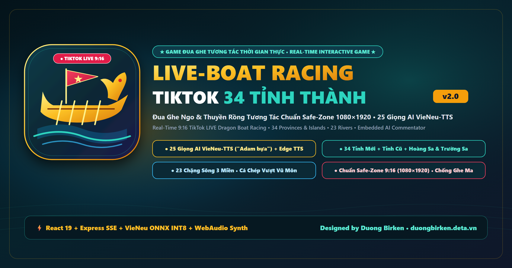
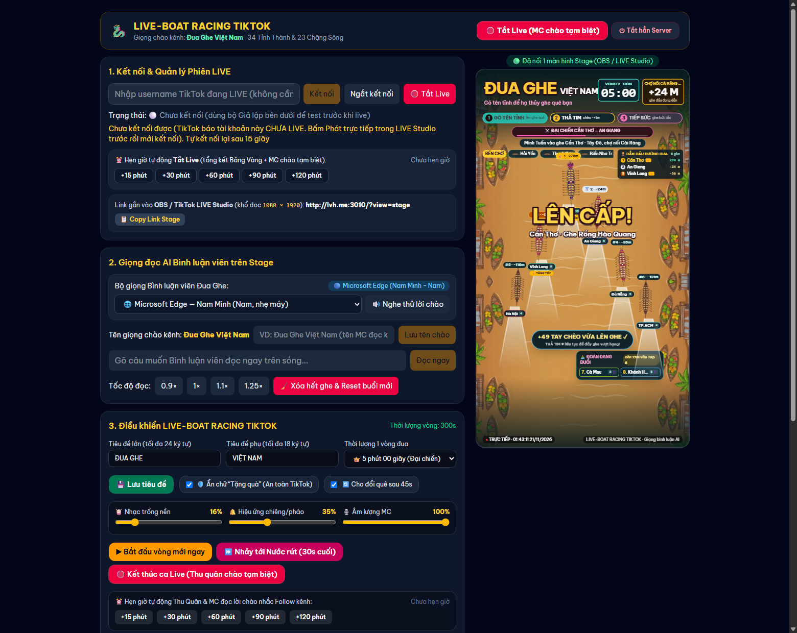
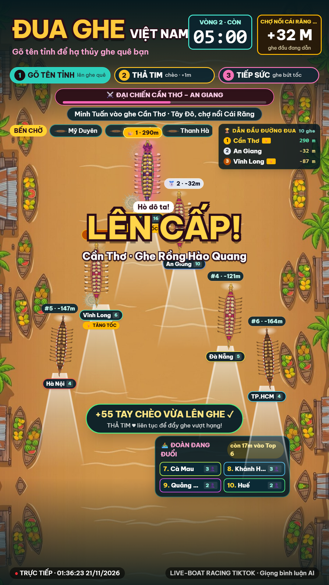
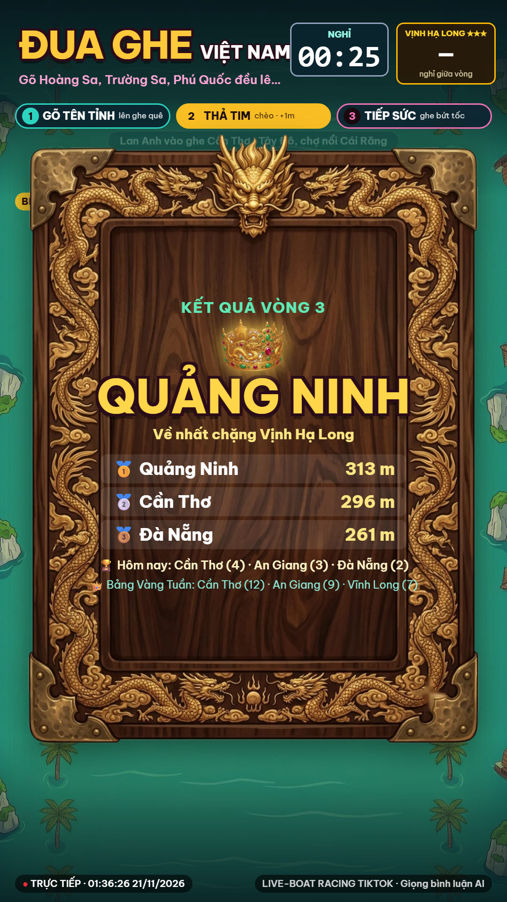
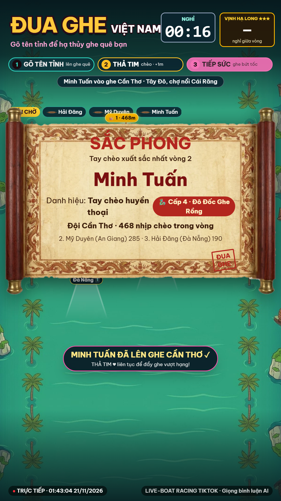

# 🐉 LIVE-BOAT RACING TIKTOK `v2.0.0` — Official Release (🇻🇳 Tiếng Việt & 🇬🇧 English)

  

---

## 📥 Tải Bộ Cài Đặt Windows 1-Click (`.EXE`) / Download Windows Installer

| Hệ điều hành / OS | File cài đặt / Installer File | Dung lượng / Đặc điểm | Link Tải Trực Tiếp / Direct Download |
| :--- | :--- | :--- | :--- |
| **💻 Windows 10 / 11 (64-bit) — Bản Cài Đặt Tự Động 1-Click *(Khuyên dùng)*** | **`LIVE-BoatRacing-Tiktok-v2.0.0-Setup.exe`** | **~33 MB** • Tích hợp sẵn Node.js Runtime + Giao diện cài đặt Tiếng Việt + Tự tạo icon Desktop & mở app (Không cần cài Node.js) | [**⬇️ Tải `LIVE-BoatRacing-Tiktok-v2.0.0-Setup.exe`**](https://github.com/duongbirken2510/LIVE-BoatRacing-Tiktok/releases/download/v2.0.0/LIVE-BoatRacing-Tiktok-v2.0.0-Setup.exe) |
| **🚀 Windows Launcher Trực Tiếp *(Dành cho bản Mã nguồn)*** | **`LIVE-BoatRacing-Tiktok.exe`** | **~16 KB** • Đặt trong thư mục dự án để bật chạy ngầm không hiện cửa sổ CMD đen | [**⬇️ Tải `LIVE-BoatRacing-Tiktok.exe`**](https://github.com/duongbirken2510/LIVE-BoatRacing-Tiktok/releases/download/v2.0.0/LIVE-BoatRacing-Tiktok.exe) |

> 💡 **Mẹo cài đặt nhanh trên Windows:** Sau khi tải **`LIVE-BoatRacing-Tiktok-v2.0.0-Setup.exe`**, nhấp đúp mở file. Nếu Windows SmartScreen hiện bảng màu xanh, bấm **More info (Thông tin thêm)** ➔ **Run anyway (Vẫn chạy)** ➔ bấm nút **`🚀 CÀI ĐẶT NGAY (1-CLICK INSTALL)`**. Phần mềm sẽ tự tạo biểu tượng **LIVE-BoatRacing-Tiktok** ngoài màn hình Desktop và mở ngay Bảng điều khiển!

---

## 🇻🇳 Điểm Mới Nổi Bật Trong Phiên Bản `v2.0.0`

1. **💿 Đóng Gói Bộ Cài Đặt Windows Độc Lập 1-Click (`LIVE-BoatRacing-Tiktok-v2.0.0-Setup.exe`):**
   - Tích hợp sẵn **Node.js Runtime (`runtime/node.exe`)**, máy chủ đóng gói `server.cjs` và giao diện Production `dist/`.
   - Người dùng cuối **không cần cài đặt Node.js**, không cần gõ lệnh — chỉ cần tải 1 file `.exe` duy nhất, bấm **Cài đặt ngay** là có biểu tượng ngoài Desktop và chạy ẩn không hiện cửa sổ CMD đen.
2. **🎙️ Nhúng Ngầm 25 Giọng Đọc AI VieNeu-TTS v3 Turbo (`onnx_int8`) + Dự Phòng 3 Tầng:**
   - Giao tiếp qua đường ống nhị phân `stdio` (`>BII` 9-byte framing) không chiếm cổng TCP `8000`, tự động dùng chung môi trường AI hoặc cài mới bằng 1 cú nhấp đúp `CAI-GIONG-ADAM.bat`.
   - Đổi nóng 25 giọng AI Việt Nam (*Adam bựa*, *Trúc Ly*...) hoặc **Microsoft Edge Neural (`Nam Minh` / `Hoài My`)** + fallback **Google TTS**.
3. **📱 Sân Khấu Dọc `1080 × 1920` Chuẩn Safe-Zone Điện Thoại TikTok:**
   - 6 làn đua phân tầng cao – thấp rõ rệt theo Thứ hạng (`👑 1`, `🥈 2`, `🥉 3`) + vệt nước chữ V.
   - Cụm **`🚣 ĐOÀN ĐANG ĐUỔI`** đặt tại `x: 508..952, y: 1430` né hoàn toàn khung bình luận góc dưới trái và dải nút Tim/Quà mép phải của TikTok.
4. **🗺️ 34 Tỉnh Thành Mới + Tỉnh Cũ Trước Sáp Nhập + Biển Đảo Tổ Quốc & 23 Chặng Sông:**
   - Gõ tên 34 tỉnh mới, tỉnh cũ trước sáp nhập (*Bến Tre, Sóc Trăng, Bình Dương, Quảng Nam, Kiên Giang...*) hoặc đảo tiền tiêu (*Hoàng Sa, Trường Sa, Phú Quốc, Côn Đảo, Lý Sơn, Cát Bà*) đều vào đúng ghe quê hương; chống bắt nhầm *"chào chị Huệ"* thành *Huế*.
5. **⚖️ Luật Chơi Công Bằng & Giữ Chân Khán Giả:**
   - **Bảo lưu 100% Quà & Tim** của khách mới chưa kịp gõ tên tỉnh (cộng bù ngay khi lên ghe).
   - **Cho phép đổi quê sau 45 giây** và tự động **lọc Ghe Ma sau 6 phút** ngưng tương tác.
   - **Bảng Vàng Hôm Nay & Tuần** + **Chiếu Sắc Phong MVP** + **5 Cấp Bậc Thủy Thủ Trọn Đời** + **🏮 Lễ Thu Quân Hạ Thủy & Hẹn giờ tự tắt Live**.

---

## 🇬🇧 What's New in `v2.0.0` (English)

- **Standalone 1-Click Windows GUI Installer (`LIVE-BoatRacing-Tiktok-v2.0.0-Setup.exe`)**: Bundles Node.js runtime, pre-built React 19 frontend, and standalone server bundle with automatic Desktop & Start Menu shortcut creation.
- **25 Embedded VieNeu-TTS v3 Turbo (`onnx_int8`) AI Voices**: Zero-port binary `stdio` worker with 3-tier failover (`VieNeu-TTS` ➔ `Microsoft Edge Neural TTS` ➔ `Google TTS`).
- **TikTok Mobile Safe-Zone 9:16 Stage (`1080 × 1920`)**: Tiered 6-lane dragon boat formation, Top 3 Leaderboard, Head-to-Head Rivalry bar, and Safe-Zone Chasing Pack widget.
- **34 Post-2025 Provinces + Pre-Merger Provinces + Sovereignty Islands & 23 Scenic Rivers**: Complete with Pending Gift/Like Escrow, 45s Province Switch, Anti-Ghost-Boat Roster Decay, Daily/Weekly Golden Leaderboards, 5 Lifetime Sailor Ranks, and Scheduled End-of-Stream Farewell Ceremony.

---

## 📸 Hình Ảnh Giao Diện / Screenshots

| 🎛️ Bàn Điều Khiển Trung Tâm & Xem Trước 9:16 | 🚣 Sân Khấu Đua Ghe 9:16 Chuẩn Safe-Zone |
| :---: | :---: |
|  |  |

| 🏆 Kết Quả Vòng & Bảng Vàng Ngày/Tuần | 📜 Chiếu Sắc Phong Tay Chèo MVP |
| :---: | :---: |
|  |  |

---

## 👨‍💻 Tác Giả & Liên Hệ / Author & Contact

| 🇻🇳 Lời nhắn từ Tác giả | 🇬🇧 Note from the Author |
| :--- | :--- |
| **LIVE-BOAT RACING TIKTOK (`v2.0.0`)** được phát triển và nâng cấp bởi **Duong Birken**. Ghé thăm website chính thức tại [**https://duongbirken.deta.vn**](https://duongbirken.deta.vn) để xem thêm các dự án AI Livestream! | **LIVE-BOAT RACING TIKTOK (`v2.0.0`)** is engineered by **Duong Birken**. Visit [**https://duongbirken.deta.vn**](https://duongbirken.deta.vn) for more AI Livestream tools and projects! |
