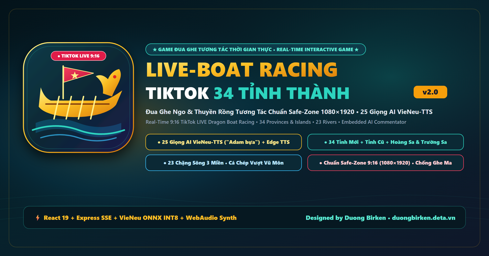
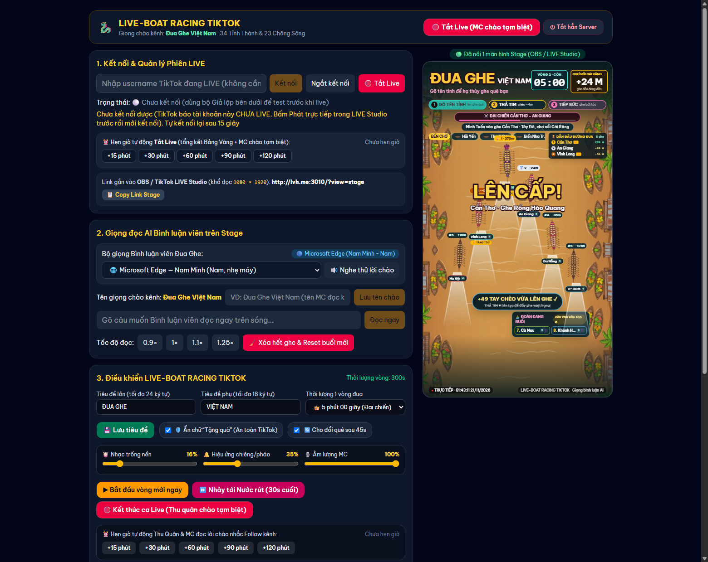
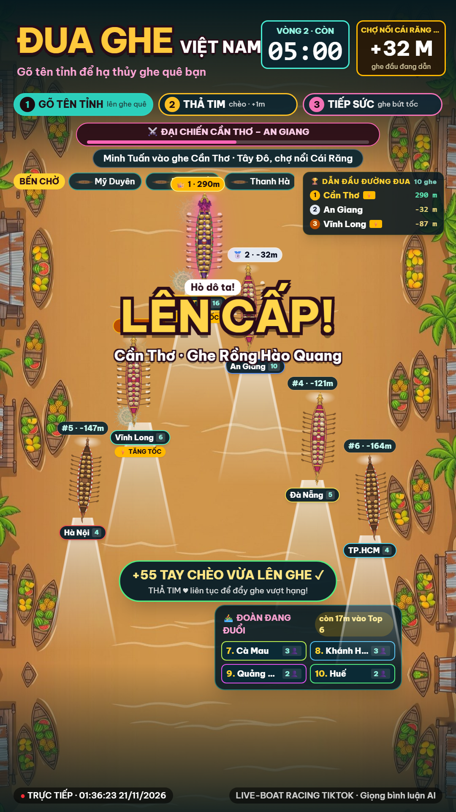
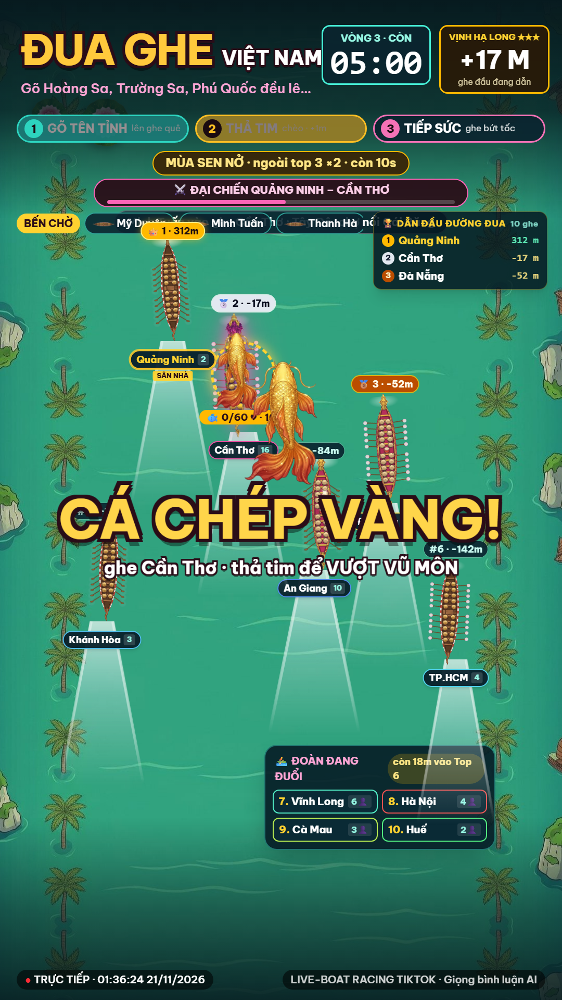
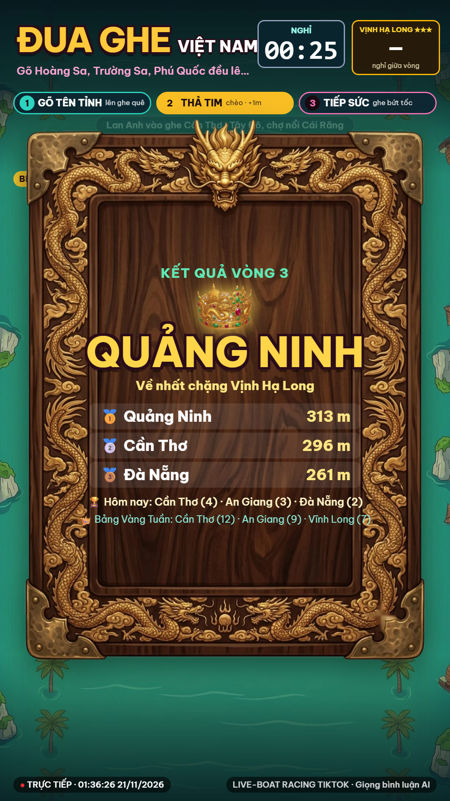
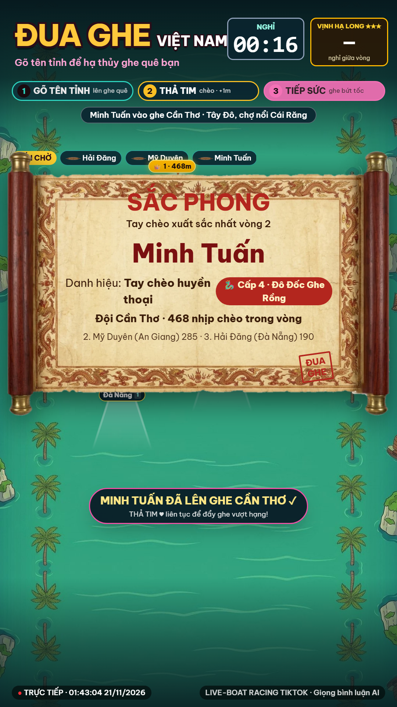
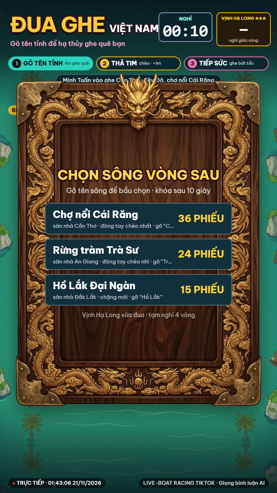
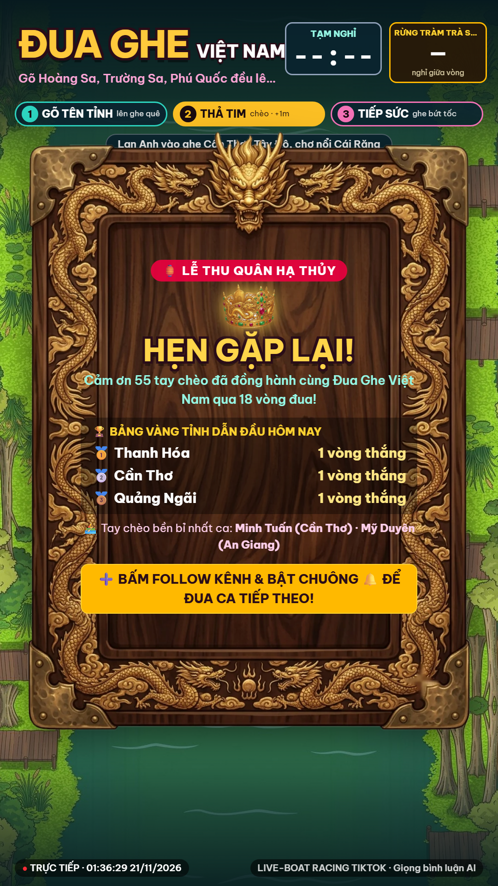

# 📖 CẨM NANG HƯỚNG DẪN SỬ DỤNG LIVE-BOAT RACING TIKTOK TOÀN TẬP (A–Z)
## LIVE-BOAT RACING TIKTOK v2.0 — Comprehensive Bilingual User Guide (Tiếng Việt 🇻🇳 & English 🇬🇧)

<div align="center">
  
</div>

> **Trang chủ Tác giả / Official Author Website:** [https://duongbirken.deta.vn](https://duongbirken.deta.vn)  
> **Kho mã nguồn & Tải về / GitHub Repository:** [https://github.com/duongbirken2510/LIVE-BoatRacing-Tiktok](https://github.com/duongbirken2510/LIVE-BoatRacing-Tiktok)  
> **Hồ sơ Kiến trúc Kỹ thuật 10 Chương / 10-Chapter Technical Whitepaper:** [`info/Introduce_LiveBoatRacingTiktok.md`](../info/Introduce_LiveBoatRacingTiktok.md)

---

## 📑 Mục Lục Nhanh / Quick Navigation
- **Phần A — 🇻🇳 Hướng Dẫn Sử Dụng Tiếng Việt (Từ A đến Z)**
  1. [Bước 1: Cài đặt & Khởi động nhanh bằng 1 cú nhấp đúp (`BAT-LIVE.bat`)](#1-bước-1-cài-đặt--khởi-động-nhanh-bằng-1-cú-nhấp-đúp-bat-livebat)
  2. [Bước 2: Đưa sân khấu dọc 9:16 (`1080 × 1920`) vào TikTok LIVE Studio & OBS Studio](#2-bước-2-đưa-sân-khấu-dọc-916-1080--1920-vào-tiktok-live-studio--obs-studio)
  3. [Bước 3: Kết nối phòng TikTok LIVE & Đổi 25 Giọng AI Bình luận viên ("Adam bựa")](#3-bước-3-kết-nối-phòng-tiktok-live--đổi-25-giọng-ai-bình-luận-viên-adam-bựa)
  4. [Bước 4: Làm chủ Luật chơi, Điều khiển Vòng đua, Sự kiện & Hẹn giờ Tự Tắt Live](#4-bước-4-làm-chủ-luật-chơi-điều-khiển-vòng-đua-sự-kiện--hẹn-giờ-tự-tắt-live)
  5. [Bước 5: Quản lý Dữ liệu Bảng Vàng, Cấp bậc Thủy Thủ & Bảo vệ An toàn Kênh TikTok](#5-bước-5-quản-lý-dữ-liệu-bảng-vàng-cấp-bậc-thủy-thủ--bảo-vệ-an-toàn-kênh-tiktok)
  6. [Bước 6: Mẹo tối ưu RAM/GPU & Xử lý sự cố thường gặp (Troubleshooting FAQ)](#6-bước-6-mẹo-tối-ưu-ramgpu--xử-lý-sự-cố-thường-gặp-troubleshooting-faq)
- **Part B — 🇬🇧 English User Guide (Step-by-Step)**
  1. [Step 1: Installation & 1-Click Launch on Windows, macOS, and Linux](#step-1-installation--1-click-launch-on-windows-macos-and-linux)
  2. [Step 2: Embedding the 9:16 Stage (`1080 × 1920`) in TikTok LIVE Studio & OBS](#step-2-embedding-the-916-stage-1080--1920-in-tiktok-live-studio--obs)
  3. [Step 3: Connecting TikTok LIVE, Configuring 25 AI Voices & Running Auto-Live](#step-3-connecting-tiktok-live-configuring-25-ai-voices--running-auto-live)
  4. [Step 4: Game Rules, Data Persistence, Safety Toggles & Troubleshooting](#step-4-game-rules-data-persistence-safety-toggles--troubleshooting)

---

# 🇻🇳 PHẦN A — HƯỚNG DẪN SỬ DỤNG TIẾNG VIỆT (TỪ A ĐẾN Z)

## 1. Bước 1: Cài đặt & Khởi động nhanh bằng 1 cú nhấp đúp (`BAT-LIVE.bat`)

### 💻 A. Trên máy tính Windows 10 / 11 (64-bit) — Khuyên dùng
1. **Cài đặt Node.js (chỉ cần làm 1 lần duy nhất):**
   - Tải và cài đặt bản **Node.js 20 LTS trở lên** tại [https://nodejs.org](https://nodejs.org).
2. **Khởi động Game ngay lập tức:**
   - Mở thư mục dự án, nhấp đúp chuột vào file **`BAT-LIVE.bat`**.
   - *(Nếu Windows hiện bảng xanh **Windows protected your PC / SmartScreen**, bạn bấm vào chữ **More info (Thông tin thêm)** ➔ bấm **Run anyway (Vẫn chạy)**).*
   - Lần đầu tiên chạy, cửa sổ sẽ tự động tải thư viện `node_modules` trong khoảng 1–2 phút, sau đó tự động mở trang **Bảng Điều Khiển (Dashboard)** trên trình duyệt tại địa chỉ:
     ```text
     http://localhost:3010
     ```
3. **Cài đặt thêm 25 Giọng AI Offline VieNeu-TTS ("Adam bựa", "Trúc Ly"...) — Tùy chọn:**
   - Ngay khi mới mở `BAT-LIVE.bat`, game đã **chạy sẵn mượt mà với 2 giọng Microsoft Edge Neural (`Nam Minh` & `Hoài My`)** mà không cần cài thêm gì.
   - Nếu trên máy bạn đã có sẵn thư mục `VieNeu-TTS` (từ các bộ `LIVE-TRANGNGUYEN` hoặc `LIVE-CLASS`), game sẽ **tự động phát hiện và dùng chung ngay**!
   - Nếu máy mới hoàn toàn và bạn muốn cài thêm **25 giọng AI VieNeu-TTS v3 Turbo Offline**:
     1. Cài **Python 3.11 hoặc 3.12** từ [https://www.python.org/downloads/](https://www.python.org/downloads/) *(nhớ tích ô **"Add python.exe to PATH"** lúc cài)*.
     2. Nhấp đúp vào file **`CAI-GIONG-ADAM.bat`** và đợi khoảng 3–5 phút để tải model `onnx_int8` (~250 MB). Từ lần sau, chỉ cần bấm `BAT-LIVE.bat` là có đủ 25 giọng!

### 🍎 B. Trên máy MacBook / iMac (macOS) & 🐧 Linux
Mở **Terminal** tại thư mục dự án và chạy 2 lệnh:
```bash
npm install
npm run dev
```
Sau đó mở trình duyệt truy cập **`http://localhost:3010`**.

---

## 2. Bước 2: Đưa sân khấu dọc 9:16 (`1080 × 1920`) vào TikTok LIVE Studio & OBS Studio



Trên trang Bảng Điều Khiển **`http://localhost:3010`**, ở cuối khung số 1 có nút **`📋 Copy Link Stage`**. Bấm vào đó để chép đường dẫn sân khấu sạch:
```text
http://lvh.me:3010/?view=stage
```

### 📱 Cách 1: Gắn vào TikTok LIVE Studio (Trực tiếp trên PC)
1. Mở phần mềm **TikTok LIVE Studio** và chuyển khung cảnh sang chế độ **Màn hình dọc (Portrait 9:16)**.
2. Bấm nút **Thêm nguồn (Add Source)** ➔ chọn **Liên kết (Link / Browser)**.
3. Cấu hình thông số nguồn Liên kết:
   - **URL:** Dán **`http://lvh.me:3010/?view=stage`**
   - **Độ phân giải (Resolution):** Chỉnh thành **`1080`** × **`1920`**
   - **Âm thanh:** Bật công tắc thu âm thanh từ nguồn Liên kết.
4. Bấm **Thêm (Add)** và kéo khung vừa khít toàn màn hình dọc.
5. *(Lưu ý: Nếu trên sân khấu hiện nút màu vàng **"🔊 Bấm vào đây để bật tiếng"**, hãy dùng công cụ tương tác chuột trong LIVE Studio/OBS bấm 1 lần vào giữa sân khấu để mở khóa âm thanh trình duyệt).*

### 🎥 Cách 2: Gắn vào OBS Studio (Phát qua Virtual Camera hoặc Stream Key RTMP)
1. Mở **OBS Studio** ➔ vào **Settings (Cài đặt) ➔ Video**:
   - **Base (Canvas) Resolution:** gõ `1080x1920`
   - **Output (Scaled) Resolution:** gõ `1080x1920`
   - **Common FPS Values:** `30` hoặc `60` FPS ➔ bấm **Apply & OK**.
2. Tại bảng **Sources (Nguồn)**, bấm dấu **`+`** ➔ chọn **Browser (Trình duyệt)**:
   - **URL:** `http://lvh.me:3010/?view=stage`
   - **Width:** `1080`
   - **Height:** `1920`
   - ✅ Tích chọn **"Control audio via OBS"** (*Điều khiển âm thanh qua OBS*).
3. Trong khung **Audio Mixer** của OBS, nếu bạn muốn vừa nghe tiếng Bình luận viên và tiếng trống hội qua loa/tai nghe vừa phát lên sóng, bấm biểu tượng bánh răng cạnh thanh âm thanh **Browser** ➔ chọn **Advanced Audio Properties** ➔ đổi cột **Audio Monitoring** thành **`Monitor and Output`**.

---

## 3. Bước 3: Kết nối phòng TikTok LIVE & Đổi 25 Giọng AI Bình luận viên ("Adam bựa")

| 🚣 Sân Khấu Đua Ghe 6 Làn Phân Tầng Chuẩn Safe-Zone 9:16 | 🐟 Sự Kiện Cá Chép Vàng Vượt Vũ Môn & Mùa Sen Nở (`×2`) |
| :---: | :---: |
|  |  |

### 3.1. Kết nối tài khoản TikTok đang phát LIVE (Mục 1 trên Dashboard)
1. **Quan trọng:** Bạn phải bấm **Phát trực tiếp (Go LIVE)** trên TikTok trước để phòng live mở cổng.
2. Tại mục **`1. Kết nối & Quản lý Phiên LIVE`** trên Dashboard (`http://localhost:3010`):
   - Nhập `username` TikTok của bạn vào ô (ví dụ: `duaghevietnam`, không cần gõ dấu `@`).
   - Bấm nút **`Kết nối`** (hoặc nhấn `Enter`).
3. Khi kết nối thành công, dòng trạng thái sẽ chuyển sang màu xanh lá:
   - **`🟢 Đang live @username · X mắt xem · Y tim`**.
   - Nếu mạng chập chờn làm rớt kết nối, máy chủ sẽ **tự động nối lại ngầm** sau mỗi `15s – 120s` mà không làm mất dữ liệu các đội ghe đang đua.

### 3.2. Chọn Giọng Đọc AI Bình Luận Viên & Đặt Tên Chào Kênh (Mục 2 trên Dashboard)
1. **Đổi nóng 25 Giọng AI VieNeu-TTS hoặc Microsoft Edge:**
   - Trong hộp chọn **`Bộ giọng Bình luận viên Đua Ghe`**, bạn có thể đổi ngay lập tức giữa:
     - **25 Giọng AI VieNeu-TTS Offline:** *`Adam bựa` (Nam · Hài hước, máu lửa)*, *`Trúc Ly` (Nữ · Trẻ trung)* và 23 giọng vùng miền Bắc – Trung – Nam khác.
     - **2 Giọng Microsoft Edge Neural Online:** *`🌐 Microsoft Edge — Nam Minh (Nam, nhẹ máy)`* và *`🌐 Microsoft Edge — Hoài My (Nữ, truyền cảm)`*.
   - Bấm nút **`🔊 Nghe thử lời chào`** để kiểm tra ngay giọng đọc trên trang Stage.
2. **Đặt Tên Giọng Chào Kênh:**
   - Gõ tên kênh của bạn (ví dụ: *`Đua Ghe Miền Tây`* hoặc *`Đua Thuyền 34 Tỉnh`*) vào ô rồi bấm **`Lưu tên chào`**. Bình luận viên sẽ tự động dùng tên này mỗi khi chào khách mới vào phòng, cảm ơn người bấm Follow và khi đọc lời chào tạm biệt cuối ca live.
3. **Nhắc Bình Luận Viên Đọc Ngay (`Đọc ngay`):**
   - Gõ bất kỳ câu thông báo nào vào ô *"Gõ câu muốn Bình luận viên đọc ngay trên sóng..."* và nhấn `Enter` (hoặc bấm **`Đọc ngay`**) để MC đọc chèn ưu tiên số 1 ngay trên sân khấu!

---

## 4. Bước 4: Làm chủ Luật chơi, Điều khiển Vòng đua, Sự kiện & Hẹn giờ Tự Tắt Live

| 🏆 Bảng Kết Quả Vòng & Bảng Vàng Tỉnh Hôm Nay / Tuần Này | 📜 Chiếu Sắc Phong Tay Chèo MVP & Cấp Bậc Thủy Thủ Trọn Đời |
| :---: | :---: |
|  |  |

### 4.1. Luật chơi tương tác thông minh giữ chân khán giả
1. **Gõ tên tỉnh lên ghe quê hương (Hỗ trợ 34 tỉnh mới + tỉnh cũ + biển đảo):**
   - Khán giả chỉ cần gõ tên tỉnh 1 lần duy nhất cho cả buổi live (ví dụ: `Cần Thơ`, `Hà Nội`, `Đà Nẵng`, `Nghệ An`...).
   - **Gõ tên tỉnh cũ trước sáp nhập** (*Bến Tre, Sóc Trăng, Bình Dương, Quảng Nam, Kiên Giang, Hải Dương, Thái Bình...*) đều tự động lên đúng ghe tỉnh mới tương ứng kèm dòng giới thiệu ấm áp trên màn hình.
   - **Gõ tên Đảo / Quần đảo Tổ quốc:** Gõ **`Hoàng Sa`** vào ghe Đà Nẵng, **`Trường Sa`** vào ghe Khánh Hòa, **`Phú Quốc`** vào ghe An Giang, **`Côn Đảo`** vào ghe TP.HCM, **`Lý Sơn`** vào ghe Quảng Ngãi, **`Cát Bà`** vào ghe Hải Phòng kèm lời bình luận viên vinh danh biển đảo Tổ quốc!
2. **4 Cấp Tiến Hóa Thuyền Rồng theo Quân Số Thực Chiến:**
   - **Cấp 0 (`1–4 người`):** *Thuyền Đua* (`+0%` tốc độ).
   - **Cấp 1 (`5–14 người`):** *Ghe Rồng* (`+5%` tốc độ).
   - **Cấp 2 (`15–29 người`):** *Ghe Rồng Hào Quang* (`+10%` tốc độ).
   - **Cấp 3 (`Từ 30 người trở lên`):** *Rồng Vàng* (`+15%` tốc độ).
   - *(Cơ chế chống "Ghe Ma": Tay chèo rời phòng quá 6 phút không tương tác sẽ tự động tạm nghỉ ở đầu vòng mới để quân số luôn phản ánh đúng người đang xem thực tế).*
3. **Bảo lưu Quà & Tim cho khách mới chưa kịp gõ tên tỉnh:**
   - Nếu khách mới vào phòng thả tim hoặc tặng quà trước rồi mới gõ tên tỉnh (trong vòng 10 phút), hệ thống sẽ **cộng bù toàn bộ số tim (tối đa 150 tim) và số giây tăng tốc** ngay khoảnh khắc họ gõ tên tỉnh!

### 4.2. Điều khiển Vòng đua, Âm lượng 3 Kênh & Kích hoạt Sự kiện Cao trào (Mục 3 trên Dashboard)
- **Chỉnh thời lượng 1 vòng đua:** Chọn nhanh từ **`1 phút 30 giây (Siêu tốc)`** đến **`5 phút 00 giây (Đại chiến)`** (mặc định chuẩn vàng là **`2 phút 30 giây`**).
- **3 Thanh trượt Âm lượng Độc lập:** Kéo chỉnh nóng theo thời gian thực:
  1. `🥁 Nhạc trống nền` (mặc định `22%`, tự động nhỏ xuống khi MC nói).
  2. `🔔 Hiệu ứng chiêng/pháo` (mặc định `35%`).
  3. `🎙️ Âm lượng MC` (mặc định `100%`).
- **Kích hoạt ngay 4 Sự kiện giữa sông hoặc Đổi nhanh 23 Khúc sông:**
  - Bấm **`🐟 Cá Chép Vàng`**, **`🐉 Sức Rồng +20%`**, **`🪨 Khúc Sông Hẹp`**, hoặc **`🪷 Mùa Sen Nở ×2`** bất cứ lúc nào muốn đẩy cao trào phòng live.
  - Chọn 1 trong **23 khúc sông 3 miền** ở hộp chọn bên phải để chuyển cảnh sông và đổi tỉnh Sân Nhà ngay lập tức.
- **Chế độ Giả lập phòng LIVE đông khách (`🤖 Bật Auto-Live`):**
  - Khi chưa bật TikTok hoặc lúc mới mở phòng còn vắng, bấm **`🤖 Bật Auto-Live (Tự động đua liên tục)`** để máy tự động sinh hàng chục tay chèo gõ tên tỉnh, thả tim và tặng hoa đua sôi động trên màn hình!

### 4.3. Hẹn giờ Tự Động Tắt Live & Lễ Thu Quân Hạ Thủy

| 🗳️ Bầu Chọn Khúc Sông Vòng Sau Bằng Bình Luận | 🏮 Màn Hình Lễ Thu Quân Hạ Thủy & Kêu Gọi Follow Cuối Ca |
| :---: | :---: |
|  |  |

- Khi muốn kết thúc buổi phát trực tiếp chuyên nghiệp (hoặc treo máy đi ngủ), bạn có thể:
  - Bấm các nút hẹn giờ **`+15 phút`**, **`+30 phút`**, **`+60 phút`**, **`+90 phút`**, **`+120 phút`**.
  - Hoặc bấm trực tiếp nút đỏ **`🛑 Tắt Live (MC chào tạm biệt)`** ở góc trên bên phải Dashboard.
- Sân khấu sẽ tự động chốt kết quả vòng đang chạy vào Bảng Vàng, mở màn hình **🏮 LỄ THU QUÂN HẠ THỦY**, hiển thị Top 3 tỉnh dẫn đầu hôm nay + Top 3 tay chèo bền bỉ nhất ca, đồng thời Bình luận viên AI đọc lời cảm ơn 34 tỉnh và nhắc khán giả bấm **➕ Follow kênh & Bật chuông thông báo 🔔** trước khi bạn tắt luồng phát.

---

## 5. Bước 5: Quản lý Dữ liệu Bảng Vàng, Cấp bậc Thủy Thủ & Bảo vệ An toàn Kênh TikTok

1. **Bật Công Tắc An Toàn TikTok (`🛡️ Ẩn chữ "Tặng quà"`):**
   - Trong mục số 3 trên Dashboard, tích chọn ô **`🛡️ Ẩn chữ "Tặng quà" (An toàn TikTok)`**.
   - Nhãn hướng dẫn số 3 trên màn hình Stage sẽ tự động đổi từ *`TẶNG QUÀ · ghe tăng tốc`* sang *`TIẾP SỨC · ghe bứt tốc`*, giúp phòng live tuyệt đối an toàn trước các đợt quét từ khóa của TikTok.
2. **Nơi lưu trữ dữ liệu bền vững (`settings.json` & thư mục `data/`):**
   - `settings.json`: Lưu tên kênh, tài khoản TikTok, giọng đọc đang chọn, thời lượng vòng và 3 mức âm lượng.
   - `data/bang-vang.json`: Lưu số trận thắng của các tỉnh trong ngày (tự reset khi sang ngày mới) và trong tuần (tự giữ từ Thứ Hai đến Chủ Nhật).
   - `data/tay-cheo.json`: Lưu tổng nhịp chèo tích lũy và số lần nhận Sắc Phong của 2.000 khán giả thân thiết nhất để phong **5 Cấp Bậc Thủy Thủ Trọn Đời** (*`⚓ Cấp 1 · Tân Binh`* ➔ *`🚣 Cấp 2 · Thủy Thủ Cứng`* ➔ *`🔱 Cấp 3 · Kiện Tướng`* ➔ *`🐉 Cấp 4 · Đô Đốc Ghe Rồng`* ➔ *`👑 Cấp 5 · Thủy Thần`*).

---

## 6. Bước 6: Mẹo tối ưu RAM/GPU & Xử lý sự cố thường gặp (Troubleshooting FAQ)

| Tình huống gặp phải | Nguyên nhân & Cách xử lý trong 5 giây |
| :--- | :--- |
| **1. Trang Stage không phát ra tiếng trống hoặc giọng Bình luận viên** | • Kiểm tra xem trong OBS / TikTok LIVE Studio đã bật thu âm thanh của nguồn **Browser / Link** chưa.<br>• Bấm chuột 1 cái vào giữa màn hình Stage (nếu có nút vàng *"🔊 Bấm vào đây để bật tiếng"*) và kiểm tra 3 thanh trượt âm lượng ở mục số 3 trên Dashboard có đang để `0%` không. |
| **2. Bấm `Kết nối` báo lỗi *"TikTok báo tài khoản này CHƯA LIVE"*** | • Tài khoản TikTok của bạn phải đang phát trực tiếp thật sự trên TikTok thì mới có phòng live để kết nối.<br>• Hãy bấm **Go LIVE** trong TikTok LIVE Studio trước, đợi 5 giây rồi mới bấm **`Kết nối`** trên Dashboard. |
| **3. Muốn máy chạy thật nhẹ khi vừa chơi vừa phát TikTok LIVE Studio** | • Tuyệt đối **không mở thêm nhiều tab `/?view=stage`** trên Chrome ngoài nguồn Browser đã gắn trong TikTok LIVE Studio / OBS.<br>• Khung xem trước bên phải Dashboard (`http://localhost:3010`) đã được bật sẵn chế độ tiết kiệm GPU (`lite=true`). |
| **4. Cổng `3010` đang bị ứng dụng khác chiếm dụng** | • Hệ thống `server.ts` có cơ chế **Tự động lùi cổng thông minh (`listenOnAvailablePort`)**: nếu `3010` bận, server tự chuyển sang `3011` và cập nhật đúng đường link Stage trên nút **`📋 Copy Link Stage`** của Dashboard. |

---
---

# 🇬🇧 PART B — ENGLISH USER GUIDE (STEP-BY-STEP)

## Step 1: Installation & 1-Click Launch on Windows, macOS, and Linux

1. **Prerequisites:** Install **Node.js `v20 LTS` or newer** from [https://nodejs.org](https://nodejs.org).
2. **Windows 10/11 (1-Click Launch):**
   - Double-click **`BAT-LIVE.bat`** in the project root.
   - *(If Windows SmartScreen appears, click **More info** ➔ **Run anyway**).*
   - On first launch, dependencies (`node_modules`) are installed automatically. The Control Dashboard opens at **`http://localhost:3010`**.
3. **Optional 25 Offline AI Voices (`VieNeu-TTS v3 Turbo` — "Adam bựa"):**
   - Out of the box, the game works immediately with **Microsoft Edge Neural TTS (`Nam Minh` & `Hoài My`)** and automatically shares any existing `VieNeu-TTS` folder from sibling projects (`LIVE-TRANGNGUYEN` or `LIVE-CLASS`).
   - To install the 25 offline Vietnamese AI voices on a fresh machine: install **Python 3.11 or 3.12** (checking *"Add python.exe to PATH"*), then double-click **`CAI-GIONG-ADAM.bat`**.
4. **macOS / Linux:**
   ```bash
   npm install
   npm run dev
   ```

---

## Step 2: Embedding the 9:16 Stage (`1080 × 1920`) in TikTok LIVE Studio & OBS

1. On the Dashboard (`http://localhost:3010`), click **`📋 Copy Link Stage`** to copy the clean broadcast stage URL:
   ```text
   http://lvh.me:3010/?view=stage
   ```
2. **In TikTok LIVE Studio:**
   - Switch to **Portrait (9:16)** canvas mode.
   - Click **Add Source ➔ Link (Browser)**, paste `http://lvh.me:3010/?view=stage`, set resolution to **`1080 × 1920`**, and enable source audio.
3. **In OBS Studio:**
   - Open **Settings ➔ Video** and set both **Base (Canvas) Resolution** and **Output (Scaled) Resolution** to **`1080x1920`**, FPS: `30` or `60`.
   - Under **Sources**, click **`+` ➔ Browser**, paste `http://lvh.me:3010/?view=stage`, set Width `1080`, Height `1920`, and check **Control audio via OBS**.

---

## Step 3: Connecting TikTok LIVE, Configuring 25 AI Voices & Running Auto-Live

1. **Connect to a Live TikTok Room (Card 1):**
   - Start your stream in TikTok LIVE Studio first, then enter your TikTok `username` (without `@`) in Card 1 and click **`Kết nối` (Connect)**.
   - Built-in exponential backoff (`15s` up to `120s`) automatically reconnects if the TikTok websocket drops during long 24/7 broadcasts.
2. **Switch AI Commentator Voices & Channel Greeting Name (Card 2):**
   - Select any of the **25 VieNeu-TTS v3 Turbo AI Voices** (such as *"Adam bựa"* or *"Trúc Ly"*) or **Microsoft Edge Neural Voices** (*Nam Minh* / *Hoài My*) from the dropdown menu.
   - Click **`🔊 Nghe thử lời chào`** to test audio on the Stage, or type a custom announcement into the Direct Speak box and click **`Đọc ngay`**.
3. **Control Race Duration, 3-Channel Audio Mixer, Mid-River Events & Auto-Live (Card 3 & Card 4):**
   - Adjust round duration (`90s` to `300s`, default `150s`) and fine-tune the 3 independent volume sliders (**Festival Drums**, **Gong/Firework SFX**, **AI Commentator Voice**).
   - Trigger mid-river events (**`🐟 Cá Chép Vàng`**, **`🐉 Sức Rồng +20%`**, **`🪨 Khúc Sông Hẹp`**, **`🪷 Mùa Sen Nở ×2`**) or switch between **23 scenic rivers** on the fly.
   - Click **`🤖 Bật Auto-Live`** to run a full crowd simulation for testing or warming up your stream before real viewers arrive.

---

## Step 4: Game Rules, Data Persistence, Safety Toggles & Troubleshooting

- **3-Step Viewer Loop:**
  1. **Type Province / Island Name** in chat (*34 post-2025 provinces, pre-merger provinces, or islands like Hoàng Sa, Trường Sa, Phú Quốc, Côn Đảo*) to board a hometown dragon boat.
  2. **Tap Hearts ♥ (`+1m/like`)** or type cheering comments on the boat (`+3m` every `8s`) to row forward.
  3. **Send Gifts / Boost (`+8m/s` for `2–60s`)** to ignite rocket propulsion.
- **Fair-Play & Retention Mechanics:**
  - **Pending Gift & Like Escrow (`10 min`):** Hearts and gifts sent before typing a province name are saved and retroactively applied the moment the viewer boards a boat.
  - **45-Second Province Switch (`🔄 Cho đổi quê sau 45s`):** Viewers who mistyped their province can switch boats after 45 seconds.
  - **Anti-Ghost-Boat Roster Decay (`6 min`):** Rowers silent for over 6 minutes rest at the start of the next round so inactive boats don't keep an unfair Golden Dragon tier.
- **TikTok Policy Safety Toggle (`🛡️ Ẩn chữ "Tặng quà"`):**
  - Check **`🛡️ Ẩn chữ "Tặng quà" (An toàn TikTok)`** in Card 3 to replace gift terminology on the stage with **`TIẾP SỨC · ghe bứt tốc`**, paired with multi-layer leetspeak profanity filtering (`src/live/bannedWords.ts`).

---

## 👨‍💻 Tác Giả & Liên Hệ / Author & Contact

- **Developed & Upgraded by:** [**Duong Birken**](https://duongbirken.deta.vn)
- **Official Website:** [**https://duongbirken.deta.vn**](https://duongbirken.deta.vn)
- **GitHub Repository:** [**https://github.com/duongbirken2510/LIVE-BoatRacing-Tiktok**](https://github.com/duongbirken2510/LIVE-BoatRacing-Tiktok)
