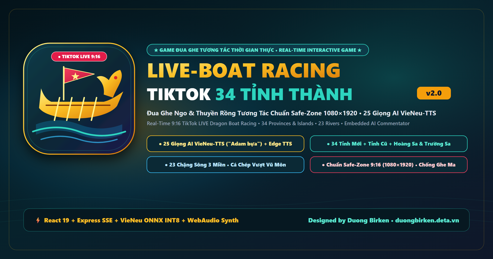
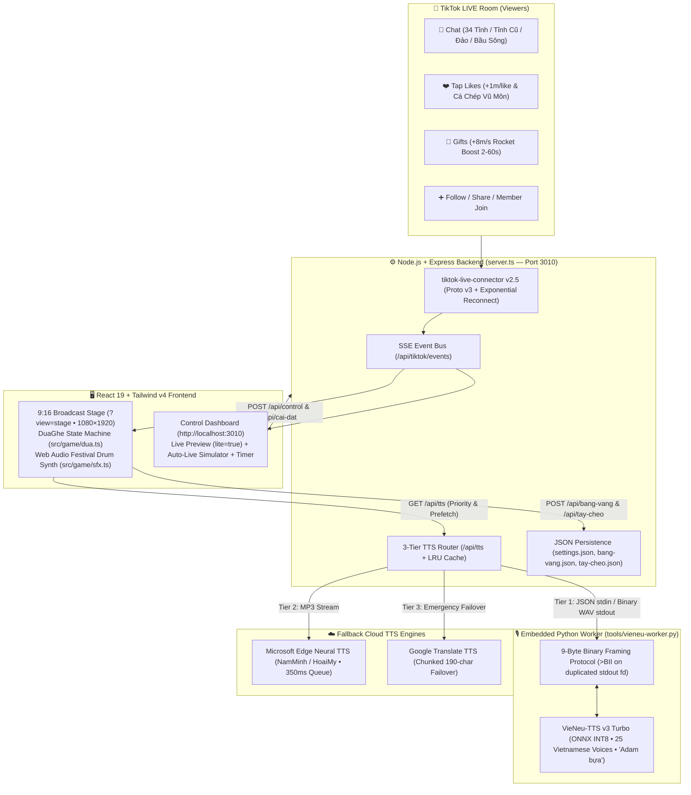
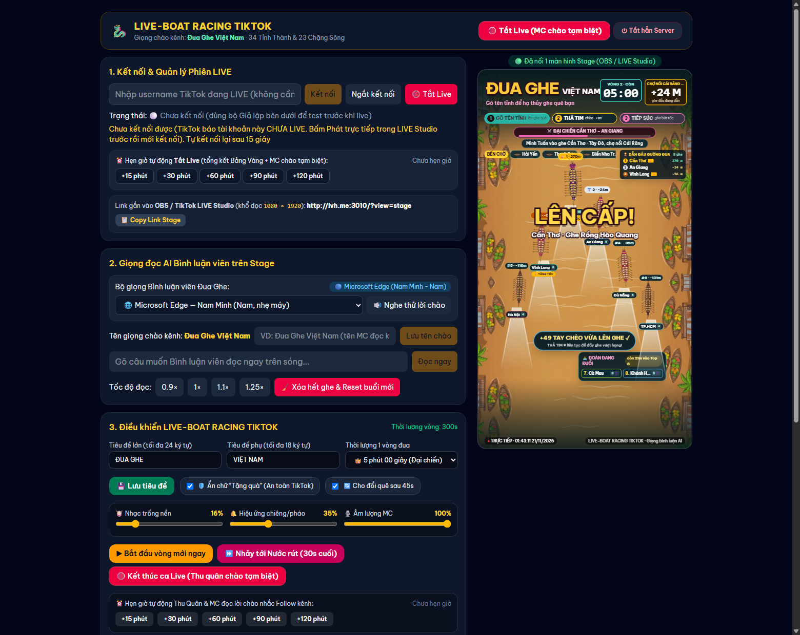
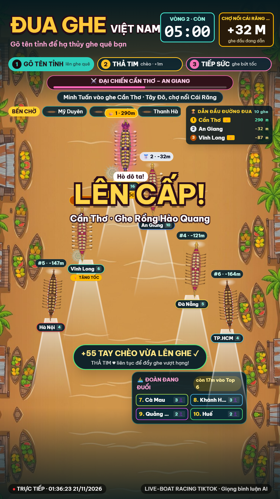
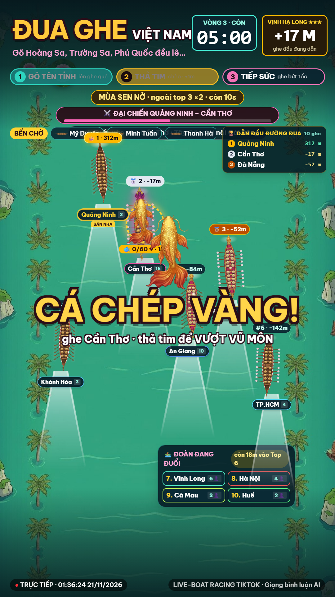
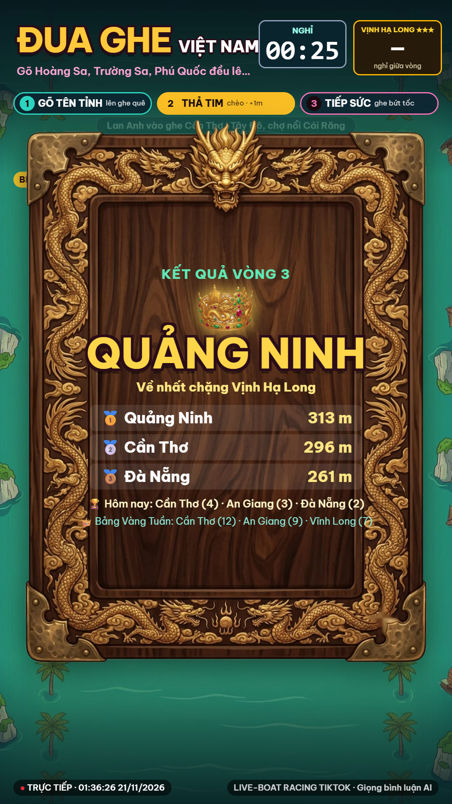
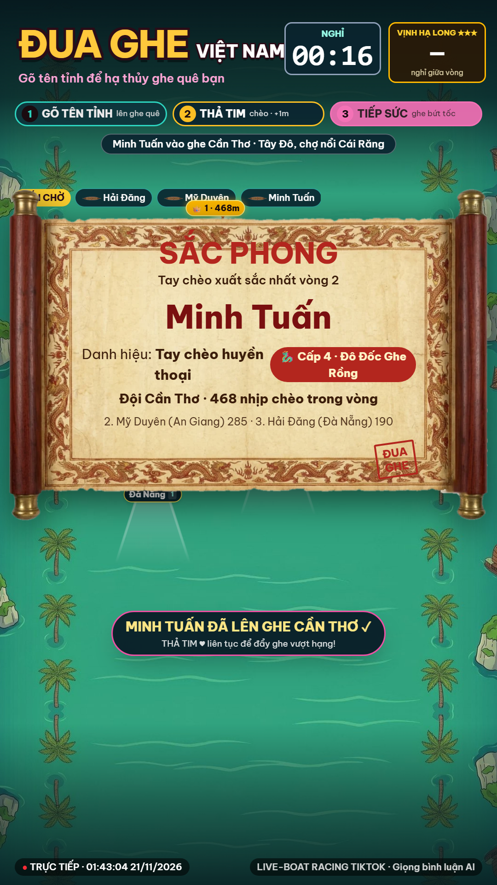
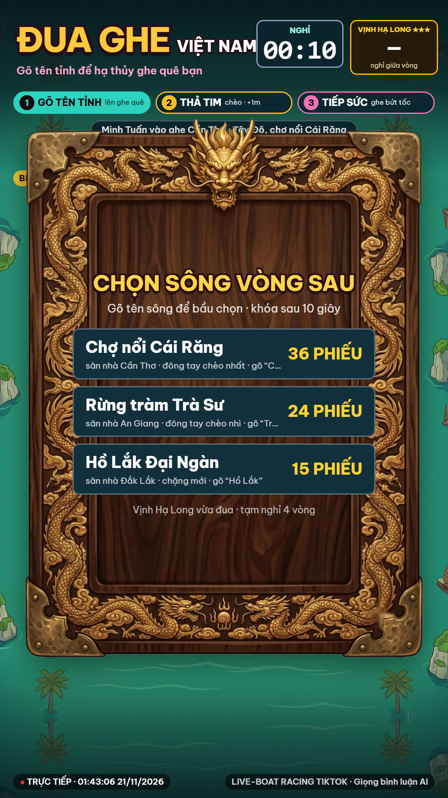
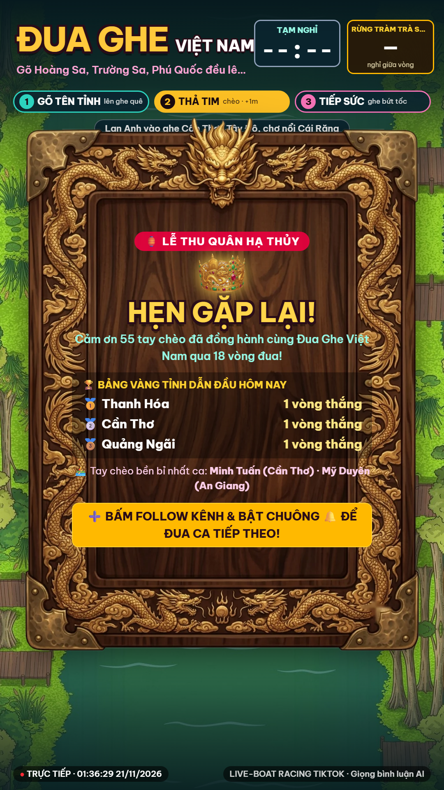
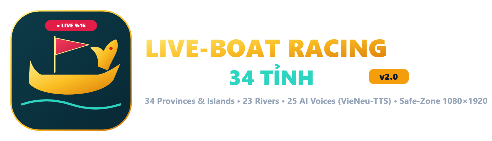

# 🐉 HỒ SƠ GIỚI THIỆU SẢN PHẨM & CÔNG NGHỆ: LIVE-BOAT RACING TIKTOK (v2.0)
## Product & Technical Whitepaper — Real-Time 9:16 TikTok LIVE Interactive Dragon Boat Racing (`1080 × 1920`)

  

> **Khẩu hiệu (Tagline):** *"34 Tỉnh Thành & Biển Đảo Tổ Quốc Cùng Hạ Thủy — Thả Tim Rẽ Sóng, Bứt Tốc Hóa Rồng Trên 23 Khúc Sông Việt Nam"*  
> **English Tagline:** *"34 Vietnamese Provinces & Sovereignty Islands — Tap Hearts to Row, Boost Into Golden Dragons Across 23 Iconic Rivers"*  
> **Nền tảng hỗ trợ (Platforms):** Windows 10/11 (64-bit), macOS, Linux • TikTok LIVE Studio & OBS Studio (`1080 × 1920` Vertical 9:16)  
> **Tác giả & Website chính thức (Author):** **Duong Birken** — [https://duongbirken.deta.vn](https://duongbirken.deta.vn)  
> **Kho mã nguồn (Repository):** [https://github.com/duongbirken2510/LIVE-BoatRacing-Tiktok](https://github.com/duongbirken2510/LIVE-BoatRacing-Tiktok)

---

## 📑 Mục Lục Nhanh / Table of Contents
1. [LIVE-BOAT RACING TIKTOK là gì? (Product Definition & Vision)](#1-live-boat-racing-tiktok-là-gì-product-definition--vision)
2. [Các Tính Năng Chính Cung Cấp Cho Người Dùng (Core Feature Matrix)](#2-các-tính-năng-chính-cung-cấp-cho-người-dùng-core-feature-matrix)
3. [Lợi Ích Mang Lại — Giải Quyết Triệt Để Những "Nỗi Đau" Gì? (Pain Points Solved)](#3-lợi-ích-mang-lại--giải-quyết-triệt-để-những-nỗi-đau-gì-pain-points-solved)
4. [Kịch Bản Thực Tế: Một Phiên Livestream Tiêu Biểu (`A Day in the Life`)](#4-kịch-bản-thực-tế-một-phiên-livestream-tiêu-biểu-a-day-in-the-life)
5. [Kỹ Thuật & Công Nghệ Chuyên Sâu Bên Dưới (Deep-Dive Technical Architecture)](#5-kỹ-thuật--công-nghệ-chuyên-sâu-bên-dưới-deep-dive-technical-architecture)
6. [Hiệu Quả Công Nghệ & Trải Nghiệm Người Dùng (Benchmarks & Comparison)](#6-hiệu-quả-công-nghệ--trải-nghiệm-người-dùng-benchmarks--comparison)
7. [Cam Kết Quyền Riêng Tư, Bảo Mật & An Toàn Cộng Đồng TikTok (Privacy & Safety Guarantee)](#7-cam-kết-quyền-riêng-tư-bảo-mật--an-toàn-cộng-đồng-tiktok-privacy--safety-guarantee)
8. [Thư Viện Hình Ảnh Giao Diện Thực Tế (`Visual Showcase`)](#8-thư-viện-hình-ảnh-giao-diện-thực-tế-visual-showcase)
9. [Cấu Hình Yêu Cầu & Câu Hỏi Thường Gặp (System Requirements & FAQ)](#9-cấu-hình-yêu-cầu--câu-hỏi-thường-gặp-system-requirements--faq)
10. [Lộ Trình Phát Triển Tiếp Theo & Liên Hệ Tác Giả (Roadmap & Author Contact)](#10-lộ-trình-phát-triển-tiếp-theo--liên-hệ-tác-giả-roadmap--author-contact)

---

## 1. LIVE-BOAT RACING TIKTOK là gì? (Product Definition & Vision)

### 🇻🇳 Định nghĩa Sản phẩm (Tiếng Việt)
**LIVE-BOAT RACING TIKTOK (`v2.0`)** là nền tảng **Game Show Đua Ghe Ngo / Đua Thuyền Rồng Tương Tác Thời Gian Thực** được thiết kế chuẩn khung dọc **9:16 (`1080 × 1920`)** dành riêng cho **TikTok LIVE Studio** và **OBS Studio**. Khán giả xem buổi phát trực tiếp không chỉ nhìn màn hình thụ động mà trực tiếp hóa thân thành **tay chèo đại diện cho quê hương mình**:
- **Bước 1 — Hạ thủy lên ghe quê (`Gõ Tên Tỉnh`):** Người xem bình luận tên một trong **34 tỉnh thành mới (sau sắp xếp 2025)**, tên **tỉnh cũ trước sáp nhập** (*Bến Tre, Sóc Trăng, Bình Dương, Hải Dương, Quảng Nam, Kiên Giang...*), hoặc tên **quần đảo / đảo tiền tiêu của Tổ quốc** (*Hoàng Sa, Trường Sa, Phú Quốc, Côn Đảo, Lý Sơn, Cát Bà, Cô Tô...*) để lập tức lên đúng chiếc ghe quê hương mình.
- **Bước 2 — Đẩy ghe rẽ sóng (`Thả Tim ♥` & `Gõ Cổ Vũ`):** Mỗi lượt thả tim đẩy ghe tiến lên **`+1 mét`** (nhân hệ số sân nhà, cấp rồng và sự kiện). Khi đã ngồi trên ghe, người xem gõ bình luận cổ vũ (*"Cố lên quê ơi!"*) còn được cộng thêm **`+3 mét`** (mỗi 8 giây) kèm bong bóng hò dô trên mặt sông.
- **Bước 3 — Bật tên lửa bứt tốc (`Tiếp Sức / Tặng Quà`):** Quà tặng kích hoạt chế độ **Tăng Tốc (`+8 m/s` trong `2–60 giây`)** kèm hiệu ứng tia nước rẽ sóng và giọng đọc AI Bình luận viên (**25 giọng VieNeu-TTS v3 Turbo ONNX INT8** như *"Adam bựa"*, *"Trúc Ly"* hoặc **Microsoft Edge Neural TTS**) gọi tên cảm ơn trực tiếp trên sóng.

### 🇬🇧 Product Overview (English)
**LIVE-BOAT RACING TIKTOK (`v2.0`)** is a real-time interactive **9:16 vertical (`1080 × 1920`) Dragon Boat & Ghe Ngo Racing Broadcast Engine** built for **TikTok LIVE Studio** and **OBS Studio**. It transforms passive TikTok viewers into active rowers competing for regional pride across **34 Vietnamese Provinces (post-2025 administrative map), all pre-merger historical provinces, and Vietnam's sacred islands (Hoàng Sa, Trường Sa, Phú Quốc, Côn Đảo, Lý Sơn, Cát Bà)**. Powered by an embedded **25-voice VieNeu-TTS v3 Turbo (`onnx_int8`) AI Commentator** communicating via a zero-port binary `stdio` pipe, a **3-tier resilient TTS fallback chain**, and a **TikTok Mobile Safe-Zone UI**, the system runs 24/7 with zero human intervention required.

---

## 2. Các Tính Năng Chính Cung Cấp Cho Người Dùng (Core Feature Matrix)

| Nhóm tính năng (Module) | 🇻🇳 Chi tiết trải nghiệm Tiếng Việt | 🇬🇧 English Technical & User Experience Details |
| :--- | :--- | :--- |
| **1. Nhận Diện 34 Tỉnh Mới + Tỉnh Cũ + Biển Đảo Tổ Quốc (`src/game/tinh.ts`)** | • Hỗ trợ đầy đủ **34 tỉnh thành sau sắp xếp 2025** kèm **tỉnh cũ trước sáp nhập** (*Bến Tre ➔ Vĩnh Long, Sóc Trăng/Hậu Giang ➔ Cần Thơ, Bình Dương/BR-VT ➔ TP.HCM, Quảng Nam ➔ Đà Nẵng, Kiên Giang ➔ An Giang...*). • Vinh danh **Biển Đảo Tổ Quốc**: gõ *Hoàng Sa* lên ghe Đà Nẵng, *Trường Sa* lên ghe Khánh Hòa, *Phú Quốc* lên ghe An Giang, *Côn Đảo* lên ghe TP.HCM kèm lời bình tự hào. • Xử lý dấu tiếng Việt thông minh trước khi chuẩn hóa: gõ *"chào chị Huệ"* hay *"sơn là"* **không bao giờ bị bắt nhầm** thành *Huế* hay *Sơn La*. | • Full dictionary of **34 post-2025 provinces**, legacy pre-merger province names, city aliases, and shorthand codes. • Dedicated sovereignty island recognition (`tenDao()`) with special patriotic AI voice commentary (`GAME.loi.bienDong`). • Pre-normalization accent guard (`FALSE_ACCENTED` regex in `prep()`) prevents false-positive matches on common Vietnamese personal names like *"Huệ"*. |
| **2. 23 Chặng Sông Nước 3 Miền & Lợi Thế Sân Nhà (`src/game/chang.ts`)** | • **23 khúc sông danh thắng** trải dài khắp Bắc – Trung – Tây Nguyên – Nam Bộ: *Chợ nổi Cái Răng, Đồng sen Tháp Mười, Rừng tràm Trà Sư, Sông Cổ Chiên, Rừng đước Đất Mũi, Sông Sài Gòn, Sông Đồng Nai, Vàm Cỏ Đông, Sông Hồng, Vịnh Hạ Long, Sông Bạch Đằng, Tràng An, Sông Cầu, Ngã ba Bạch Hạc, Sông Mã, Sông Lam, Nhật Lệ, Sông Hương, Sông Hàn, Đầm Thị Nại, Vịnh Nha Trang, Hồ Xuân Hương, Hồ Lắk*. • Mỗi chặng có **Tỉnh Sân Nhà (`+10% tốc độ`)** và bầu chọn sông trực tiếp bằng bình luận cuối mỗi vòng (`CHỌN SÔNG VÒNG SAU`). | • **23 scenic river stages** with seamless scrolling water textures, dual riverbanks (`public/assets/song/` & `public/assets/bo/`), and regional CSS color filters (`locMau`). • **Home-River Advantage (`+10% speed multiplier`)** for the host province and interactive viewer chat voting between rounds. |
| **3. 25 Giọng Đọc AI VieNeu-TTS v3 Turbo Nhúng Ngầm (`tools/vieneu-worker.py`)** | • Nhúng trực tiếp **25 giọng AI Việt Nam VieNeu-TTS v3 Turbo (`onnx_int8`)** — nổi bật với giọng **"Adam bựa"** (hài hước, máu lửa) và **"Trúc Ly"**. • Giao tiếp qua **đường ống nhị phân `stdio` (`fd` duplicate)** ngay trong 1 tiến trình duy nhất, không mở cửa sổ CMD thứ 2, không chiếm cổng TCP. • **Cơ chế dự phòng 3 tầng bất tử**: `VieNeu-TTS Offline` ➔ `Microsoft Edge Neural TTS (NamMinh / HoaiMy)` ➔ `Google Translate TTS`. | • Embedded Python worker (`tools/vieneu-worker.py`) running `VieNeu-TTS v3 Turbo` (`int8` ONNX Runtime) over a custom 9-byte binary framing protocol (`>BII`) on duplicated `stdout`. • Auto-discovers existing `VieNeu-TTS` installations across sibling projects or installs in 1 click via `CAI-GIONG-ADAM.bat`. • 3-tier automatic failover with `UnhandledPromiseRejection`-safe Edge TTS streaming and LRU audio caching. |
| **4. Bố Cục Sân Khấu 9:16 Chuẩn Safe-Zone TikTok (`src/game/GameStage.tsx`)** | • Đường đua **6 làn rộng thoáng (`LAN_X`)** phân tầng cao – thấp rõ rệt theo Thứ hạng (`STEP_HANG = 96px`) kết hợp khoảng cách mét thực tế, giúp người xem nhìn lướt qua điện thoại biết ngay ai đang dẫn đầu (`👑 1`, `🥈 2`, `🥉 3`). • Cụm **`🚣 ĐOÀN ĐANG ĐUỔI`** đặt tại tọa độ **`x: 508..952, y: 1430`**, né hoàn toàn khung bình luận góc dưới trái và dải nút Tim/Quà mép phải của ứng dụng TikTok. • Chế độ **`lite=true`** trên bản xem trước Dashboard tắt các lớp `drop-shadow` nặng, giảm 50% tải GPU. | • Tiered vertical boat positioning (`yMui()`) combining rank step offset (`96px`), exponential meter-gap decay, and real-time tap-velocity surge (`chom`). • **TikTok Mobile Safe-Zone Layout**: keeps `x: 0..500, y: 1350..1850` clear of critical HUD panels so TikTok's native chat overlay never obscures rankings. • GPU-saving `lite` preview mode for single-PC broadcast setups. |
| **5. Luật Chơi Công Bằng: Bảo Lưu Quà/Tim & Chống "Ghe Ma" (`src/game/dua.ts`)** | • **Bảo lưu Tim & Quà chưa lên ghe (`this.treo`)**: Khách mới vào phòng lỡ thả tim (tối đa `150 tim`) hoặc tặng quà trước khi gõ tên tỉnh sẽ được **giữ nguyên trong 10 phút** — vừa gõ tên tỉnh là kích hoạt cộng bù mét và đẩy tên lửa ngay! • **Cho phép đổi quê sau 45 giây** (có nút bật/tắt trên Dashboard) giúp khách gõ nhầm vẫn về được đội quê thật. • **Lọc "Ghe Ma" (`nghiNguoiSauMs = 6 phút`)**: Tay chèo rời phòng quá 6 phút tự động tạm nghỉ đầu vòng mới để tránh ghe giữ cấp *Rồng Vàng* ảo. | • **Pending Heart & Gift Escrow (`this.treo`)**: stores up to `150 likes` and `60s` of gift boost for 10 minutes before a viewer picks a province, triggering an instant retroactive `congBu` boost upon boarding. • **45-Second Province Switch Cooldown** (`choDoiGhe` toggleable). • **Anti-Ghost-Boat Roster Decay**: rowers inactive for `> 6 minutes` are marked `active = false` at round transition, dynamically recalculating boat evolution tier (`capCua`). |
| **6. 4 Sự Kiện Cao Trào Giữa Sông & Đại Chiến Song Mã** | • **🐟 Cá Chép Vàng (`Vượt Vũ Môn`)**: Trồi lên cạnh ghe đang bám đuổi trong 10 giây; thả đủ tim cá chép hóa rồng phóng vọt lên tới `+140m`. • **🐉 Sức Rồng Nhập Thể**: Tăng `+20%` tốc độ chèo trong `20 giây`. • **🪨 Khúc Sông Hẹp**: Hai bờ đá lấn vào ghìm ghe hạng 1 còn `80%` tốc độ trong `12 giây`. • **🪷 Mùa Sen Nở**: Toàn bộ ghe ngoài Top 3 được **nhân đôi sức chèo (`×2 mét`)** trong `10 giây` để lật kèo. • **⚔️ Đại Chiến Song Mã**: Tự động xuất hiện thanh giằng co khi Top 1 và Top 2 cách nhau `< 25m`. | • Automated & manually triggerable mid-river events (`kichHoatSuKien`): **Golden Carp Leap (`caChep` ➔ `vuMon`)**, **Dragon Might (`sucRong` +20%)**, **Narrow Gorge (`songHep` -20% on leader)**, and **Lotus Bloom (`senNo` 2× catch-up multiplier for ranks 4+)**. • Real-time head-to-head rivalry bar (`v.daiChien`) when Top 1 and Top 2 are within `25m`. |
| **7. Bảng Vàng Ngày/Tuần, Sắc Phong MVP & Lễ Thu Quân (`server.ts`)** | • **Bảng Vàng Hôm Nay & Bảng Vàng Tuần (`data/bang-vang.json`)**: Lưu bền vững số vòng vô địch của từng tỉnh trong ngày và từ đầu tuần. • **Chiếu Sắc Phong & 5 Cấp Bậc Thủy Thủ Trọn Đời (`data/tay-cheo.json`)**: Vinh danh tay chèo xuất sắc nhất vòng kèm cấp bậc tích lũy (*Tân Binh ➔ Thủy Thủ Cứng ➔ Kiện Tướng ➔ Đô Đốc Ghe Rồng ➔ Thủy Thần*). • **🏮 Lễ Thu Quân Hạ Thủy & Hẹn Giờ Tự Tắt Live (`+15p..+120p`)**: Tổng kết Bảng Vàng, MC cảm ơn 34 tỉnh và nhắc khán giả bấm **Follow + Chuông thông báo 🔔**. | • Persistent JSON storage for daily/weekly provincial championships (`data/bang-vang.json`) and lifetime rower profiles (`data/tay-cheo.json`, auto-pruned to top 2,000 rowers). • End-of-round **Imperial Decree MVP (`SacPhong`)** displaying round title and lifetime rank. • **Scheduled & 1-Click Stream Farewell Ceremony (`ManNghiLive`)** with voice sign-off and Follow CTA. |

---

## 3. Lợi Ích Mang Lại — Giải Quyết Triệt Để Những "Nỗi Đau" Gì? (Pain Points Solved)

1. **Giải quyết nỗi đau "Khán giả tặng quà/thả tim trước khi gõ tên tỉnh bị mất trắng":**
   - *Nỗi đau thực tế:* Ở các bản game đua ghe cũ, người xem mới lướt vào thấy vui liền bấm thả tim hoặc tặng hoa hồng ngay, sau đó mới đọc hướng dẫn và gõ tên tỉnh. Toàn bộ quà và tim trước đó bị hệ thống bỏ qua khiến người xem hụt hẫng.
   - *Giải pháp của LIVE-BOAT RACING TIKTOK:* Kho bảo lưu `this.treo` trong `src/game/dua.ts` tự động ghi nhận tối đa `150 tim` và `60 giây tăng tốc` cho mọi `username` chưa có ghe. Ngay khoảnh khắc họ gõ tên tỉnh, hàm `duaVaoGhe()` lập tức kích hoạt sự kiện `congBu`, đẩy ghe vọt lên kèm lời bình luận viên đọc tên vinh danh trên sóng!
2. **Giải quyết nỗi đau "Ghe Ma giữ cấp Rồng Vàng ảo đè bẹp các đội mới":**
   - *Nỗi đau thực tế:* Sau 30–60 phút phát live, một tỉnh tích lũy được hơn 30 người từng gõ bình luận nhưng 25 người đã thoát phòng. Ghe đó vẫn giữ vĩnh viễn cấp 3 (*Rồng Vàng* `+15% tốc độ` và tự trôi nhanh), làm các đội tỉnh khác dù đang thả tim thật cũng không thắng nổi.
   - *Giải pháp của LIVE-BOAT RACING TIKTOK:* Cơ chế **Quân Số Thực Chiến (`nghiNguoiSauMs = 6 phút`)** kiểm tra thời gian tương tác gần nhất (`n.hoatDong`) ở đầu mỗi vòng đua mới (`chuyen()`). Tay chèo im lặng quá 6 phút sẽ tạm chuyển sang `active = false` và tính lại cấp ghe thực tế; ngay khi họ thả tim hoặc bình luận trở lại, `kichHoatNguoi()` lập tức đưa họ về lại đội ghe mà không cần gõ lại tên tỉnh.
3. **Giải quyết nỗi đau "Giao diện bị chữ bình luận TikTok trên điện thoại che khuất":**
   - *Nỗi đau thực tế:* Trên màn hình điện thoại TikTok, góc dưới bên trái (`x: 0..500, y: 1300..1850`) bị khung chat trực tiếp đè lên, còn mép phải (`x: 960..1080`) là cột Avatar, Tim, Chia sẻ, Quà tặng.
   - *Giải pháp của LIVE-BOAT RACING TIKTOK:* Bố cục `GameStage.tsx` đặt bảng **🏆 DẪN ĐẦU ĐƯỜNG ĐUA** ở góc trên phải mặt sông (`top: 406px`), thông báo **Lên Ghe (`Toast`)** ở `top: 1325px` (không bao giờ che mũi ghe Top 1–2–3), và bảng **🚣 ĐOÀN ĐANG ĐUỔI** gọn tại `left: 508px, top: 1430px, width: 444px` — hiển thị rõ 100% trên mọi màn hình điện thoại iOS/Android.
4. **Giải quyết nỗi đau "Cài đặt giọng AI phức tạp, mở nhiều cửa sổ đen hoặc sập server khi Edge TTS nghẽn mạng":**
   - *Nỗi đau thực tế:* Các bản dùng giọng AI rời thường bắt người dùng mở 2–3 cửa sổ CMD, dễ xung đột cổng `8000`, hoặc bị sập tiến trình Node.js khi `msedge-tts` gặp lỗi `UnhandledPromiseRejection` lúc đứt mạng.
   - *Giải pháp của LIVE-BOAT RACING TIKTOK:* Nhúng trực tiếp worker Python `tools/vieneu-worker.py` vào `server.ts` qua đường ống nhị phân `stdio` (`windowsHide: true`), tự động tìm môi trường `VieNeu-TTS` có sẵn trên máy, đồng thời bọc khóa `read.catch(() => {})` và xếp hàng tuần tự `350ms` cho `MsEdgeTTS` kèm fallback `Google TTS` giúp server chạy bền bỉ 24/7 không bao giờ sập.

---

## 4. Kịch Bản Thực Tế: Một Phiên Livestream Tiêu Biểu (`A Day in the Life`)

| Thời điểm / Giai đoạn | Tình huống thực tế của Chủ kênh & Khán giả | Cách **LIVE-BOAT RACING TIKTOK** vận hành tự động |
| :--- | :--- | :--- |
| **1. Khởi động (00:00)** | Chủ kênh bấm đúp file **`BAT-LIVE.bat`**, mở **TikTok LIVE Studio** phát trực tiếp, rồi nhập `username` trên Dashboard `http://localhost:3010`. | Server tự khởi động ở cổng `3010`, nạp ngầm 25 giọng AI VieNeu-TTS (*Adam bựa*), kết nối phòng LIVE TikTok và đồng bộ sang nguồn Browser `http://lvh.me:3010/?view=stage`. |
| **2. Hạ thủy & Nhận diện Quê hương (00:30)** | Khán giả khắp nơi vào phòng gõ: *"Cần Thơ ơi"*, *"Bến Tre"*, *"Hoàng Sa thân yêu"*, *"Trường Sa"*, *"chào chị Huệ"*. | • *Cần Thơ* hạ thủy ghe Cần Thơ. • *Bến Tre* tự động lên ghe **Vĩnh Long** kèm dòng chữ *"Bến Tre nay về chung Vĩnh Long"*. • *Hoàng Sa* lên ghe **Đà Nẵng**, MC đọc vang: *"Tự hào Hoàng Sa thân yêu của Tổ quốc! Thêm một tay chèo tiếp lửa cho ghe Đà Nẵng!"* • Câu *"chào chị Huệ"* được bộ lọc `prep()` nhận diện là tên người, không bắt nhầm vào ghe Huế. |
| **3. Bảo lưu Quà khách mới (01:15)** | Một vị khách mới vào phòng tặng ngay **Bó hoa (30 xu)** khi chưa kịp gõ tên tỉnh, 10 giây sau mới gõ *"An Giang"*. | Lúc tặng hoa, MC cảm ơn và báo đã giữ sẵn **`+6 giây tăng tốc`**. Ngay khi khách gõ *"An Giang"*, ghe An Giang lập tức bật lửa **⚡ TĂNG TỐC 6 giây** đuổi sát Cần Thơ! |
| **4. Cao trào Giữa sông & Nước rút (02:00)** | Ghe Cần Thơ và An Giang kè nhau dưới `25m`, đồng hồ điểm `00:30` bước vào pha **NƯỚC RÚT**. | Nhạc trống hội Web Audio tự động tăng nhịp từ `112 BPM` lên **`150 BPM`**, thanh **⚔️ ĐẠI CHIẾN CẦN THƠ – AN GIANG** rực sáng, **🐟 Cá Chép Vàng** trồi lên cạnh ghe An Giang kích thích khán giả bấm tim dồn dập để **Vượt Vũ Môn**. |
| **5. Cán đích, Sắc Phong & Bầu chọn Sông (02:30)** | Hết giờ đua, ghe Cần Thơ cán đích hạng nhất; tay chèo `Minh Tuấn` thả nhiều tim nhất vòng (`468 nhịp`). | • Hiện bảng gỗ **KẾT QUẢ VÒNG** + **Bảng Vàng Hôm Nay & Tuần**. • Cuộn chiếu **SẮC PHONG** vinh danh `Minh Tuấn` (*Tay chèo huyền thoại · 🐉 Cấp 4 Đô Đốc Ghe Rồng*). • Mở bảng **CHỌN SÔNG VÒNG SAU** trong 10 giây để khán giả gõ bầu chọn khúc sông mới. |
| **6. Lễ Thu Quân Hạ Thủy (Cuối ca Live)** | Chủ kênh hẹn giờ tự tắt `+90 phút` (hoặc bấm nút **`🛑 Tắt Live`**). | Màn hình chuyển sang **🏮 LỄ THU QUÂN HẠ THỦY**, vinh danh Top 3 tỉnh vô địch trong ca và Top 3 tay chèo bền bỉ nhất, MC đọc lời chào tạm biệt ấm áp và kêu gọi khán giả bấm **Follow kênh + Bật chuông 🔔**. |

---

## 5. Kỹ Thuật & Công Nghệ Chuyên Sâu Bên Dưới (Deep-Dive Technical Architecture)

### 5.1. Sơ Đồ Kiến Trúc Tổng Thể (System Architecture Diagram)

### 5.2. Giao Thức Nhị Phân `stdio` Nhúng Giọng AI VieNeu-TTS (`server.ts` & `tools/vieneu-worker.py`)
- Thay vì chạy một máy chủ HTTP FastAPI riêng biệt tốn RAM và dễ đụng cổng `8000`, `server.ts` khởi chạy trực tiếp `tools/vieneu-worker.py` bằng `child_process.spawn` với `stdio: ['pipe', 'pipe', 'inherit']` và `windowsHide: true`.
- Ngay ở dòng đầu tiên của `tools/vieneu-worker.py`, worker nhân bản file descriptor `stdout` gốc (`_proto_fd = os.dup(1)`) rồi chuyển hướng toàn bộ `fd 1` sang `stderr` (`os.dup2(2, 1)`). Nhờ đó, bất kỳ lệnh `print()` nào của thư viện Python hay log C++ của `onnxruntime` đều đi ra `stderr`, giữ cho luồng `_proto_out` **100% tinh khiết nhị phân**.
- Mỗi khung dữ liệu (`Frame`) truyền từ Python về Node.js có header cố định **9 byte (`struct.pack(">BII", frame_type, req_id, len(payload))`)**:
  - `FRAME_READY (1)`: Gửi danh sách 25 giọng đọc JSON ngay sau khi nạp xong model `v3turbo` (`int8`) và warm-up.
  - `FRAME_CHUNK (2)`: Truyền từng mảnh PCM 16-bit (`48,000 Hz`) kèm header WAV streaming ngay khi câu nói đang được tổng hợp, giúp độ trễ phát âm thanh chỉ khoảng **`180–350ms`**.
  - `FRAME_DONE (3)` & `FRAME_ERROR (4)`: Đóng luồng và lưu kết quả vào bộ nhớ đệm `vieneuCache` (LRU 150 câu) để các câu bình luận lặp lại phát tức thì trong **`0.01 giây`**.

### 5.3. Lõi Máy Trạng Thái Độc Lập `DuaGhe` (`src/game/dua.ts`) & Kiểm Thử Tự Động (`src/game/dua.check.ts`)
- Toàn bộ logic đua ghe được đóng gói trong class `DuaGhe` (`src/game/dua.ts`) hoàn toàn không phụ thuộc vào React hay DOM, vận hành qua 6 pha trạng thái (`Phase`):
  `chuyen` (`4s`) ➔ `dua` (`60s–360s`, mặc định `150s`, `30s` cuối là `nuocRut`) ➔ `ketQua` (`9s`) ➔ `sacPhong` (`6s`) ➔ `chonSong` (`10s`) ➔ lặp lại `chuyen` (hoặc chuyển sang `nghiLive` khi chủ kênh bấm Tắt Live / hết hẹn giờ).
- Công thức tọa độ mũi ghe trên sân khấu dọc (`yMui(g, dauM)` trong `src/game/GameStage.tsx`):
  $$\text{yMui} = \text{clamp}_{[454, 1075]}\left(472 + (\text{hang} - 1)\times 96 + 185\times\left(1 - e^{-\frac{\text{dauM} - g.m}{65}}\right) - \text{clamp}_{[-16, 16]}\left((g.\text{toc} - g.\text{tocTB})\times 4\right)\right)$$
  Công thức này kết hợp **bậc thang thứ hạng cố định (`96px`/hạng)** với **độ lùi hàm mũ theo khoảng cách mét thực tế** và **độ chồm mũi ghe tức thời khi khán giả dồn tim**, tạo cảm giác đua thuyền rồng sống động và rõ thứ hạng tuyệt đối.

### 5.4. Bộ Tổng Hợp Trống Hội & Chiêng Pháo Web Audio API 0% Bản Quyền (`src/game/sfx.ts`)
- Không cần phụ thuộc vào file nhạc MP3 bên ngoài dễ dính bản quyền âm nhạc TikTok, class `Sfx` trong `src/game/sfx.ts` sử dụng trực tiếp các bộ dao động `AudioContext` (`OscillatorNode` + `BiquadFilterNode` + White Noise Buffer) để tổng hợp:
  - **Nhạc trống hội thời gian thực (`lich()`)**: Tự động đổi nhịp từ `112 BPM` (đang đua) lên `150 BPM` (30 giây nước rút) và `84 BPM` (nghỉ giữa vòng), đồng thời tự động **hạ nhỏ âm lượng (`Auto-Ducking` xuống `45%`)** mỗi khi Bình luận viên AI đang cất tiếng nói (`dangNoi = true`).
  - **6 Hiệu ứng âm thanh lễ hội (`SYNTH`)**: Tiếng chiêng đồng (`chieng`), tiếng lên ghe (`len`), tiếng rẽ nước tăng tốc (`vut`), tiếng trống bùng nổ (`bung`), kèn hiệu về đích (`kenHieu`) và pháo hoa sắc phong (`phao`).

---

## 6. Hiệu Quả Công Nghệ & Trải Nghiệm Người Dùng (Benchmarks & Comparison)

| Tiêu chí đánh giá | Các bản Game Đua Ghe TikTok thông thường | Hiệu quả thực tế trên **LIVE-BOAT RACING TIKTOK (`v2.0`)** |
| :--- | :--- | :--- |
| **Hệ thống Giọng đọc Bình luận viên** | Chỉ có 1 giọng Google/Edge cứng nhắc hoặc phải mở thêm cửa sổ CMD chạy server Python cổng `8000` rất dễ lỗi. | **25 giọng AI VieNeu-TTS v3 Turbo (`onnx_int8`)** nhúng ngầm qua `stdio` trong 1 cửa sổ duy nhất + dự phòng 3 tầng (`VieNeu` ➔ `Edge Nam/Nữ` ➔ `Google TTS`). |
| **Nhận diện Tỉnh thành & Biển Đảo** | Chỉ nhận đúng 63 tỉnh cũ hoặc 34 tỉnh mới, gõ *"chị Huệ"* bị bắt nhầm vào ghe *Huế*, không nhận tên đảo. | Nhận diện cả **34 tỉnh mới + toàn bộ tỉnh cũ trước sáp nhập + đảo tiền tiêu (Hoàng Sa, Trường Sa, Phú Quốc, Côn Đảo, Lý Sơn, Cát Bà)**; chống bắt nhầm *"chị Huệ"*. |
| **Bố cục hiển thị trên điện thoại TikTok** | Danh sách ghe phía sau nằm ở góc dưới trái bị khung bình luận TikTok che mất hoàn toàn. | Thiết kế **Safe-Zone `1080 × 1920`**: cụm *Đoàn Đang Đuổi* đặt ở `x: 508..952`, thông báo lên ghe ở `y: 1325`, không bị che bởi bình luận hay nút Tim/Quà. |
| **Quyền lợi khách mới & Công bằng trận đấu** | Tặng quà/thả tim trước khi gõ tỉnh bị mất trắng; khóa chết 1 tỉnh cả buổi; ghe đông người thoát phòng vẫn giữ cấp Rồng Vàng ảo. | **Bảo lưu 100% Quà & Tim chưa lên ghe** (cộng bù ngay khi gõ tỉnh); cho phép **đổi quê sau 45s**; tự động **lọc Ghe Ma sau 6 phút** ngưng tương tác. |
| **Tải GPU & Độ ổn định khi Live 24/7** | Bản xem trước trên Dashboard render toàn bộ hiệu ứng nặng làm giật OBS/TikTok LIVE Studio; dễ crash khi Edge TTS timeout. | Chế độ **`lite=true`** trên Dashboard giảm 50% tải GPU; khóa chống `UnhandledPromiseRejection` và tự động lùi cổng nếu cổng `3010` đang bận. |

---

## 7. Cam Kết Quyền Riêng Tư, Bảo Mật & An Toàn Cộng Đồng TikTok (Privacy & Safety Guarantee)

1. **Chống Tấn Công DNS Rebinding & Chỉ Chạy Cục Bộ (`server.ts`)**:
   - Máy chủ Express chỉ lắng nghe trên địa chỉ loopback `127.0.0.1` và kiểm tra nghiêm ngặt header `Host` / `Origin` (`LOCAL_HOSTS = new Set(['localhost', '127.0.0.1', 'lvh.me'])`), từ chối mọi truy cập trái phép từ trang web bên ngoài (`HTTP 403`).
2. **Chốt Chặn Đa Lớp Bảo Vệ Tiêu Chuẩn Cộng Đồng TikTok LIVE (`src/live/bannedWords.ts` & `src/live/names.ts`)**:
   - **Không bao giờ đọc nguyên văn nội dung bình luận tự do** của người xem lên sóng; Bình luận viên AI chỉ đọc từ kho câu mẫu an toàn kết hợp với tên hiển thị đã qua kiểm duyệt.
   - Hàm `isRudeName()` giải mã cả biến thể leetspeak (`l0n`, `đ!t`, `djt123`), chữ lặp (`loooon`) và chữ chấm cách (`đ.ị.t`) để tự động đổi các nickname nhạy cảm thành `"Tay chèo ẩn danh"` trên màn hình và `"bạn"` khi đọc tên.
   - Công tắc **`🛡️ Ẩn chữ "Tặng quà" (An toàn TikTok)`** ngay trên Dashboard giúp đổi nhãn bước 3 trên sân khấu thành **`TIẾP SỨC · ghe bứt tốc`** để tránh thuật toán TikTok quét từ khóa kêu gọi quà tặng.
3. **100% Dữ Liệu Lưu Trữ Cục Bộ (`settings.json` & `data/`)**:
   - Mọi thông tin cấu hình kênh, Bảng Vàng tỉnh thắng (`data/bang-vang.json`) và hồ sơ tay chèo (`data/tay-cheo.json`) đều lưu thuần túy trên ổ cứng máy tính của chủ kênh, không gửi bất kỳ dữ liệu cá nhân nào lên máy chủ trung gian.

---

## 8. Thư Viện Hình Ảnh Giao Diện Thực Tế (`Visual Showcase`)

### 8.1. Bàn Điều Khiển Trung Tâm & Xem Trước Sân Khấu 9:16 Thời Gian Thực (`http://localhost:3010`)

### 8.2. Sân Khấu Đua Ghe 9:16 (`1080 × 1920`) & Sự Kiện Cá Chép Vượt Vũ Môn (`?view=stage`)
| 🚣 Đường Đua 6 Làn Phân Tầng & Đoàn Đang Đuổi Chuẩn Safe-Zone | 🐟 Sự Kiện Cá Chép Vàng Vượt Vũ Môn & Mùa Sen Nở (`×2`) |
| :---: | :---: |
|  |  |

### 8.3. Bảng Kết Quả Vòng + Bảng Vàng Ngày/Tuần & Chiếu Sắc Phong Tay Chèo Xuất Sắc Nhất
| 🏆 Kết Quả Vòng Đua & Bảng Vàng Tỉnh Hôm Nay / Tuần Này | 📜 Chiếu Sắc Phong Tay Chèo MVP & Cấp Bậc Thủy Thủ Trọn Đời |
| :---: | :---: |
|  |  |

### 8.4. Bình Chọn Khúc Sông Vòng Tiếp Theo & Lễ Thu Quân Hạ Thủy Cuối Ca Live
| 🗳️ Khán Giả Bình Chọn Sông Bằng Bình Luận (`CHỌN SÔNG VÒNG SAU`) | 🏮 Lễ Thu Quân Hạ Thủy (`Tắt Live` & Nhắc Bấm Follow Kênh) |
| :---: | :---: |
|  |  |

### 8.5. 3D Studio Social Hero (`16:9` Official Brand Asset)

---

## 9. Cấu Hình Yêu Cầu & Câu Hỏi Thường Gặp (System Requirements & FAQ)

### 💻 Cấu Hình Máy Tính Khuyến Nghị
- **Hệ điều hành:** Windows 10 / Windows 11 (64-bit), macOS 12+, hoặc Linux.
- **Phần mềm nền tảng:** **Node.js `v20 LTS` trở lên** (bắt buộc).
- **Tùy chọn Giọng AI Offline (`VieNeu-TTS`):** **Python `3.11` hoặc `3.12`** (nếu muốn cài 25 giọng AI Việt Nam offline bằng `CAI-GIONG-ADAM.bat`; nếu chưa cài Python, game vẫn chạy ngay lập tức với giọng Microsoft Edge Nam Minh & Hoài My).
- **RAM & CPU:** Tối thiểu `8 GB RAM` (khuyến nghị `16 GB RAM` khi chạy đồng thời cùng TikTok LIVE Studio hoặc OBS Studio).

### ❓ Câu Hỏi Thường Gặp (FAQ)
1. **Làm sao để bật 25 giọng AI VieNeu-TTS ("Adam bựa")?**
   - Nếu trên máy bạn đã cài `VieNeu-TTS` (trong thư mục dự án hoặc ở `../LIVE-TRANGNGUYEN/VieNeu-TTS`, `../LIVE-CLASS/VieNeu-TTS`), server sẽ **tự động phát hiện và nạp ngay** khi mở `BAT-LIVE.bat`. Nếu máy mới chưa có, bạn chỉ cần cài Python 3.11/3.12 rồi nhấp đúp **`CAI-GIONG-ADAM.bat`**.
2. **Tại sao bấm Kết nối TikTok báo lỗi tài khoản chưa LIVE?**
   - Thư viện `tiktok-live-connector` yêu cầu kênh TikTok của bạn **phải đang phát trực tiếp (Go LIVE)** thì mới có `roomId` để vào lấy bình luận. Nếu bạn chỉ muốn thử game trước khi lên sóng, hãy bấm nút **`🤖 Bật Auto-Live (Tự động đua liên tục)`** ở mục số 3 trên Dashboard!
3. **Làm sao để không bị vọng 2 tiếng nói chồng nhau khi vừa mở Dashboard vừa mở OBS?**
   - Hệ thống đã tự động xử lý: chỉ duy nhất trang Stage (`http://lvh.me:3010/?view=stage`) được cấp quyền phát tiếng (`IS_STAGE`), còn khung xem trước trên trang Dashboard (`http://localhost:3010`) luôn tự động tắt tiếng (`lite` preview).

---

## 10. Lộ Trình Phát Triển Tiếp Theo & Liên Hệ Tác Giả (Roadmap & Author Contact)

### 🚀 Lộ Trình Phát Triển (`Roadmap v2.x`)
- **v2.1:** Bổ sung chế độ **Giải Đấu Liên Tỉnh Cuối Tuần (Tournament Bracket 34 Tỉnh)** với vòng Tứ Kết – Bán Kết – Chung Kết tự động.
- **v2.2:** Hỗ trợ kết nối đồng thời đa nền tảng (**TikTok LIVE + YouTube Shorts LIVE + Shopee LIVE + Facebook LIVE**) cùng đua trên một mặt sông.
- **v2.3:** Tích hợp hiệu ứng thời tiết động trên sông (Mưa rào miền Tây, Sương mù Vịnh Hạ Long, Đèn hoa đăng đêm Hội An) và bảng xếp hạng Thủy Thủ xuất sắc theo tháng.

### 👨‍💻 Tác Giả & Liên Hệ / Author & Contact

  

| 🇻🇳 Lời nhắn từ Tác giả | 🇬🇧 Note from the Author |
| :--- | :--- |
| **LIVE-BOAT RACING TIKTOK (`v2.0`)** là dự án tâm huyết được phát triển và nâng cấp toàn diện bởi **Duong Birken**. Nếu dự án mang lại những buổi phát trực tiếp sôi động cho kênh của bạn, hãy tặng một ngôi sao (**⭐ Star**) trên GitHub hoặc ghé thăm website chính thức để kết nối và giao lưu nhé! | **LIVE-BOAT RACING TIKTOK (`v2.0`)** is engineered with passion by **Duong Birken**. If this project powers engaging livestreams for your channel, please consider giving it a **⭐ Star** on GitHub or visiting the official website to connect and share your feedback! |

- **🌐 Website chính thức & Liên hệ tác giả:** [**https://duongbirken.deta.vn**](https://duongbirken.deta.vn)
- **📦 Kho mã nguồn GitHub:** [**https://github.com/duongbirken2510/LIVE-BoatRacing-Tiktok**](https://github.com/duongbirken2510/LIVE-BoatRacing-Tiktok)
- **📜 Giấy phép (License):** MIT License (cảm ơn tác giả bản gốc *Ghe Ngo 34 Tỉnh* `aitivjvu-jpg`).
